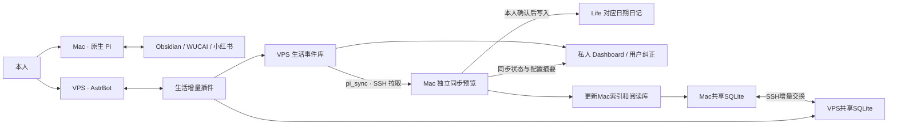

# Personal Asis 总规格

修订：2026-10-20。当前架构以本文件和 [ADR 0037](docs/adr/0037-use-two-agents-and-confirmed-daily-sync.md) 为准。旧 PA0–PA5／P0–P4 验收是日期快照，不定义本轮部署。

## 1. 分工

Mac 与 VPS 各自执行职责，均可在另一端不在线时使用。没有旧协调队列、跨节点模型综合、全库复制或替代 AstrBot 的自建模型循环。

## 2. Mac 知识 Agent

原生 Pi 管理模型、会话、shell／文件工具、资源与 MCP。Study／Life 按需读取；WUCAI 中国区使用既有缓存和官方 API；小红书复用现有回环 MCP 与 Keychain 会话。来源正文不在启动时加载整库，SQLite 是可选发现途径。Folo、知乎和公众号不加入本轮主线。

笔记写入前显示目标与改动，获得本次用户确认。平台写入通过窄 `source_write` 扩展：WUCAI 日记追加、页面笔记更新、文章状态；小红书点赞／取消、收藏／取消、发表评论。每次原生 UI 显示完整参数并确认，计划五分钟有效，执行前落盘一次占位。未知结果保留防重，不自动重试。不包含发布图文／视频、删平台文章、自动社交互动或后台抓取。

VPS AstrBot 的 Google Calendar 写入只在本人已绑定私聊中开放新增、修改和删除单个非重复事件的提案；创建不添加参会者，修改／删除拒绝含参会者的事件，且不发通知。事件、日历、现有状态和完整变更预览由插件生成；仅同一私聊在五分钟内发送精确一次性确认命令才执行。确认前不调用写工具；确认码先消费再请求，未知网络结果不自动重试。OAuth 保留 `calendar.readonly`，仅增加 `calendar.events.owned`，不能写入本人不拥有的日历；不开放批量、重复事件、邀请响应、日历管理或共享设置。

扩展不限制 Pi 的正常回答、检索、模型选择或上下文。原生 shell 不是受控 OS 沙箱，不能声称仅凭此扩展就封锁了绕过操作。原生 Pi／AstrBot 的费用各归原提供商，旧 Asis 预算并不覆盖；保留旧账本数值和未知请求标记。

小红书可接入多个本人账号：会话／指纹 seed／服务鉴权／回环端口独立，Pi 按账号分别注册只读 MCP；新增账号不合并旧单账号缓存。多账号写入必须明确账号，完整确认预览显示该账号，执行按同一标识选择服务；不自动选择身份。新增会话只接受本人手工导出和隐藏输入，不从浏览器抽取 Cookie。

本人另行授权初始化本机统一阅读资料库：WUCAI近90天与两个小红书账号当前可见收藏，保留旧缓存及回退。资料内容按哈希去重，账号关系与可见版本独立，划线／批注保持归属；时间、日期窗口、继续位置和未知覆盖显式记录。原生Pi可按问题检索、读取及补取已采集条目正文，不加载整库、不调用旧Core。2026-10-26进一步授权将所选文本与出处进入两端共享库，来源凭据与原始附件仍保留Mac。没有新增后台采集、完整小红书历史、图像OCR、视频转写或平台删除推断。见[资料库](docs/reading-library.md)。

## 3. VPS 生活 Agent

AstrBot 本体保留模型、渠道与会话；`astrbot_plugin_life_agent` 补充以下能力：

- 仅指定平台、已绑定本人的私聊：普通聊天保存为助手记忆，`/life`正文标为主动记录；按消息身份去重，不导入整段历史会话或附件。模型工具不能把普通聊天误提升为随记或行为。
- 原话独立保存，模型通过工具整理为日常、健康、准备睡觉、起床、时间事项。摘要注明可修正，不将推测自动确认为事实。
- 默认以消息接收时间归档；用户补记由模型显式提供带时区的所属时间。对应日期按 Asia/Shanghai 计算，跨日可修订。
- `/life` 查看状态，`/life list` 列近期记录，`/life delete ID` 删除 VPS 正文并产生删除标记。`/life` 后的非管理命令文本作为日常记录，保存后仅回执“已记下”，随后进入AstrBot原生当前会话／人格／Agent工具流程自然回应，保留完整多行内容；不另造模型循环。普通私聊仍可自然交流并留作记忆；只有 `/life` 正文可进入日记，普通聊天不能自动成为习惯／学习观测。关闭收录时仍可对话，失败或关闭时不得声称已保存。晚安固定回执简短，不附带整段规则状态。
- 明确的到期事项可通过既有本人渠道提醒。每15秒检查一次，发送前持久占位；平台返回成功／未知分别记账。服务崩溃留下的 `sending` 属待核对，不自动重发。不发送本轮测试消息。
- 本人明确开启的催睡规则按 Asia/Shanghai 每天01:00起，每10分钟提醒一次，持续到本人说晚安，没有白天截止。前一晚中午12:00至当天中午12:00归为同一睡前窗口；该窗口内的简短“晚安”“睡觉了”等完整自述或 `/life goodnight` 停止当晚催睡，并在收录开启时直接保存为睡前自述。引用、否定、问句、历史补记不自动触发停止。`/life sleep` 查看，`/life sleep on`／`off` 开关每天规则，也接受完整文本“开启睡觉提醒”／“关闭睡觉提醒”。首次开启从下一个01:00开始，不补催白天；规则、停止标记及发送占位在VPS持久保存。服务恢复只发一个当前提醒，不补发积压；每个未知投递不重试，十分钟后的下一次独立催睡仍继续。提醒文案按睡前窗口及轮次轮换，首条轻量提示晚安停止，不每条附管理命令；仅引用当前本人睡前窗口内最近50条主动记录中通过证据校验的学习主题，不将普通聊天、旧背景、历史／未来记录或他人内容当作当前活动，也不从未回晚安推断仍清醒。升级时将已排定的旧5分钟后续提醒顺延到10分钟，保留开关及晚安停止状态。该规则独立于一次性事项提醒开关，不调用模型或自动创建cron。
- `life_context` 按需读取本人授权的初始化背景；与新消息、正式任务和提醒分开。另支持经本人确认的小份 `personal_profile`：最多16条带相对出处／行号／哈希的生活与学业摘要，标明自述、文档计划、资料地图和暂定解释；最多4条、800字的简要背景进入本人私聊的原生模型请求，完整背景按需读取。草案只能本地预览，不能作为已批准记忆加载；包含Study的上传需本人确认具体摘要，不能复用仅Life的旧初始化授权。`/life context` 查看当前背景，`/life forget-context` 删除当前VPS两种背景及工作区说明，不声称撤回聊天历史或备份。
- `life_recent` 只读近期主动记录与对话记忆，按capture_source区分；`vps_workspace` 仅查看系统磁盘／时间、列出和读写生活工作区 Markdown 草稿。该插件不提供任意 shell、sudo、凭据、Mac 全库或其他项目权限。AstrBot原生Computer Use是本人另行配置的能力：`local` 在VPS服务用户环境执行，受当前会话配置／管理员与人格工具选择控制，不能声称由生活工作区目录规则形成OS沙箱，也不因此获得Mac来源权限。

VPS 可以持久保存本人发送的生活文本，这是本轮明确的数据驻留改变。目录0700、数据库／私密文件0600；不记录原话到项目日志。现有 AstrBot／平台自身历史遵循各自保留设置，不把插件删除报告为所有副本删除。

## 4. 独立同步

`pi`／`scripts/asis-pi` 直接打开本地原生 Pi，所有启动模式均不执行同步或等待 VPS。独立运行 `pi_sync`／`scripts/pi_sync`（兼容 `scripts/asis-life-sync`）执行三步：VPS事件拉回与日记预览确认；Mac索引及阅读库刷新；共享库双向增量交换，并上传原有状态摘要。默认由已获准MiMo为待同步随记编排主题与位置，仅处理当天Freewrite和待排原话，每日一份有界方案、每轮最多4次调用；不加载Pi历史、全库或工具，正文在本机原样渲染。输入相同复用私密缓存，失败／未知不自动重发；`--retry-layout`显式重试，`--layout plain`选择原话追加。模型不可用时暂缓日记，仍更新共享库。日记跳过或VPS离线仍更新本机派生库，失败／超出上限保留游标，下次显式运行继续；非交互不连接、不刷新、不提问、不写日记。

目标来自已配置的Life根目录，日记相对目录 `Calendar/Journal/Daily`，文件 `YYYY-MM-DD.md`。仅 `/life` 主动记录的生活经历与反思结合当日日记内容编排在Freewrite的 `---` 之前，相关补充接入对应段落或已有H4下，独立话题在节末按需新增具体H4，不再固定追加“聊天随记”，正文与分节符之间正好空一行；不得进入后面的multi-column习惯／学习卡片。按原话自然分段，去掉展示中的历史命令前缀，不重复模型摘要、不调用模型重写。Markdown不再生成 `astrbot:…` 注释，来源身份、正文定位快照及文件哈希只保存于本机私密收据；旧标记及错入卡片的同步内容先完整预览确认再迁移。用户手记、分栏设置、其他标题与尾部嵌入保留，缺Freewrite时补建，重复标题或正文定位歧义时停止核对。修订、移日和删除按记录归属重新预览，不删除其他手记。

Freewrite默认排除睡前／起床类型与纯作息回执、问候、管理命令、独立日期／时间澄清、任务类型与明确提醒请求，不以字数短或含“睡”字判断内容价值。仅包含已结构化习惯／学习证据的消息不再重复搬入Freewrite；额外生活感受仍保留，Habits／Learning按既有独立投影处理。排除只改变日记投影，不删除VPS原话或关闭提醒。SSH仍消费完整增量以处理修订和删除。旧碎片副本的移除与旧格式迁移均需预览确认，不自动修改真实日记。投影收据保存格式版本与当前是否有副本，兼容旧收据；已写入但缺收据时只补本机元数据，不要求确认空改动。

同步时按日期与目标栏目显示完整变更段落，修订显示完整前后内容，不截断；`d`／`--diff`查看精确原始diff。只有输入“确认写入”才执行整批，跳过仍待下次。先复核文件、来源与排除项，保存私密待提交批次的前后哈希和定位收据，再逐文件原子替换；中断后按各文件实际落盘状态恢复，不重复追加，未完成部分仍重新预览。手动修改同步正文、位置歧义、文件并发变化、越界或符号链接时停止，不猜测覆盖。多个文件不是整体事务，日记写入确认不扩大平台或背景发布权限。

本机缓存与收据保存在忽略的私密 Pi 配置目录。删除在下一次成功拉取时覆盖本机待同步正文；离线 Mac、旧备份和平台副本需分别处理。每轮拉取有页数／大小／超时限制，超出留下一轮处理。

本人另行选择 `pi_sync` 同时处理个人背景：`profile_sync_mode=confirm` 时，通过固定SSH接口 `profile_transfer` 拉回VPS当前已批准的背景与内容版本到本机私密快照，并检查该背景已引用的来源哈希／排除项／符号链接边界。来源变化仅提示需要核对，不自动生成摘要或扫描新笔记。Mac Pi可在本人要求下准备私密 `personal-profile-next.json` 背景候选；同步显示差异与确认后完整背景，输入“确认更新背景”后重新核对候选和来源，再按VPS预览版本条件替换。与Obsidian的“确认写入”分别生效。并发修改会拒绝覆盖；未知发送结果不自动重发，下次先读回版本核对。远端无背景时清空当前快照，不拿旧批准副本自动恢复；新的发布仍需具体候选与当次确认。`check` 模式仅检查、`off` 关闭；非交互执行不连接或消费管道输入。快照是最近一次同步状态，不等于实时、也不自动进入Pi模型上下文。

2026-10-26本人选择同一逻辑数据库、两端SQLite副本：共享Life／Study的Markdown索引文本、五彩划线批注、小红书已采集正文与出处，不传原始附件、凭据、会话或绝对路径。范围以当前根目录身份和账号固定，不自动扩展。Mac拥有notes／reading，VPS拥有life，两端分别拥有独立补充annotations；不以时钟覆盖对方来源，补充编辑校验预期版本，不反写原库。通过SSH固定shared_transfer交换约1MB、最多200条的分页增量，默认50页；同版本同内容幂等、同版本内容冲突拒绝、删除保留tombstone并撤回相应补充。只有对应来源完整可用的扫描才能判定删除，平台部分可见页不推断取消收藏。两端直接读取本机副本，不新增常驻数据库端口。详见[共享资料库](docs/shared-library.md)及[ADR 0038](docs/adr/0038-replicate-origin-owned-sqlite-library.md)。

Mac索引复用现有增量逻辑，未变笔记不重读或重传；五彩刷新最近7天至多2页，小红书按独立账号读取当前收藏页，保留正文与覆盖缺口。共享正文分块保留出处、取得时间、内容哈希和账号，先检索再读取；VPS只对已绑定本人开放shared_knowledge，资料是数据而非执行指令，不预载整库。精选背景仍单独预览发布，源哈希变化不等于已自动重写背景。

## 5. Dashboard

2026-10-26增量：本人授权飞书习惯与开放主题学习整理、最多3个持续目标、每3天08:00–09:00简报及周一前一周周报；同日合并、数据不足提醒同步。Habits／Learning先保留VPS并显示在认证看板，`pi_sync`在既有Life日记相应区块投影，继续完整预览后逐批确认；具体行为与证据／暂停／删除边界见[习惯与学习](docs/habits-learning.md)。2026-10-29本人要求综合Life Journal、五彩与小红书：简报读取既有已授权共享副本，按近期生活主线选材，复用AstrBot当前提供商每份最多一次有界模型综合，不带工具或会话历史；来源／版本可追溯，标题收藏不当正文、划线不当阅读完成。90秒失败退回明确的来源片段预览、不自动重试；独立任务避免拖住催睡与事项。发送前复核授权、来源及时间窗口，更新／撤回清理缓存；无新增平台后台采集。本人反馈仍然机械后，写法改为私人来信，篇幅通常可舒展至900至1600字，不固定段数／栏目或强制收成建议；来源统一文末呈现，内部保留逐段证据。本人另行选择带回曾提过的随手想法：有界回看30天的本人记录／聊天记忆及Journal，自然提起至多2个，已引用后14天内不重复；核对后续完成／取消，缺续记只称状态未确认，不自动创建待办／目标／提醒，普通聊天不进入日记或行为观测。详见[综合简报](docs/habits-learning.md)。

认证后的PWA展示最近100条AstrBot生活记录、事项和提醒状态；Dashboard的Mac状态接口只接收最近检查时间、待确认／已同步数量及四个来源是否配置，不接收原笔记、根路径、密钥或会话。共享文本通过独立SSH库接口及本人Bot工具使用，不新增Dashboard任意资料搜索路由。另可通过source_write的Dashboard发布操作预览完整标题／正文并确认一份选定摘要；看板显示最近确认的一份，没有自动遍历笔记。来源配置不等于账户实时可用，上次同步不等于实时在线。

复用现有 HTTPS 与已有本人登录密码的哈希；切换时清除旧会话。服务绑定 VPS loopback，由 nginx 转发。POST用于登录／退出与本人反馈队列，均检查Origin，反馈必须有已认证会话及CSRF；API 不缓存，页面按文本渲染记录，旧 PWA service worker 缓存清除。Dashboard无任意资料搜索、远程文件执行或授权变更入口。纠正对话通过私密SQLite队列交给既有AstrBot原生tool_loop_agent，最多4步，只暴露绑定单条记录和版本的correct_record工具；支持清除误判习惯／学习、修正摘要／行为整理、排除误入随记的记录，原始消息保留。本人反馈逐字保留为独立证据，不能冒充原始聊天。请求ID幂等，执行前占位；中断标为结果未知，不自动重发。实际改动回执单独展示，日记变更仍需pi_sync预览确认。

## 6. 退役与保留

移除旧 `astrbot_plugin_personal_asis`、旧搜索 PWA、协调／Relay／worker、旧飞书卡片代码与相应 CLI／部署模板／测试／运维文档。保留可回退的服务器旧发布、数据库、凭据和平台配置；不触及无关 AstrBot 插件。Mac 旧轮询／隧道退出后不再连接退役接口。

旧本地 Core、检索、角色、语义模型、付费工作状态仍供显式兼容，不迁移真实会话与账本。原始资料和既有本机缓存保留。历史 ADR 与验证记录保留日期并注明已被新架构修订。

## 7. 验收

合成测试须覆盖消息去重、时区与补记、提醒未知防重、删除清理、拉取分页、同步跳过／确认／重复／中断、跨日期修订、目标越界／符号链接／并发变更、平台计划精确确认与防重、Dashboard 认证与无外部控制路由。

现场检查实际 SDK 注册、VPS 服务／旧服务下线、SSH 导出、Mac 启动入口和 MCP 工具目录。真实聊天、模型整理质量、到期消息投递、真实 Obsidian 写入与真实平台操作单独验收，禁止合成成功冒充现场完成。详见[状态](docs/project-status.md)与[验证记录](docs/validation/two-agent-20261020.json)。

## 8. 2026-10-20 内容初始化

用户本轮明确要求Codex读取对应资料并初始化两边，选择VPS最近30天。Life窗口为2026-09-21至2026-10-20；Mac可读取获准Study知识资料与现有阅读缓存，形成仅本机保存的知识／使用背景，原生Pi只按需读取其私密文件。VPS只接收所选生活摘要及相对出处，不接收Study、整库、Mac绝对路径或凭据。

背景保留自述、历史候选与暂定解释的区别，习惯模板／他人讲话／既有AI回答不归为用户事实。没有可靠截止时间的旧任务不自动启用提醒，初始化不产生待同步事件，原日记不改动。Dashboard可展示已初始化的生活背景，与后续消息列表分开。Codex本轮读取不自动为Pi新增云提供商许可。

## 2026-10-27 Learning 分栏与统一追踪

Habits／Learning日记投影把multi-column的end-column／end-multi-column作为真实栏目边界，忽略代码块中的示例标题与标记，End-of-Day和日记底部嵌入属于栏目外。旧区块不再原地更新：先移除已识别副本，再放入相应栏内。Learning按实际主题H4分组，条目用时间／开始、进展、结束与原话自然排版；不重复复制模型摘要。仅当Missing、C++、Research三项都为旧的未勾选占位时清理它们，已有完成项和手写内容保留。

活动正文不再写入asis身份注释，版本、位置、当前正文与文件哈希只保存在本机私密activity_applied收据。旧标记和页尾错位在完整预览确认后迁移。新的正文被手动改动或位置歧义时停止核对，不猜测覆盖；正常修订、移日、删除与中断恢复延续同一确认批次。

学习追踪页复用现有Dataview，以日记Learning为来源，按年份／主题／关键词筛选，统一显示热力图、有记录的天数、主题数及最近记录，并链接回原日记；任意新主题自动出现，兼容旧字段和已勾选学习项并标为旧打卡。没有按空白日期推断未学习，也不把结束视作掌握或计算实际专注时长。视图只读、无外部请求；页内包含独立脚本，不需新插件或额外资源文件。真实追踪页替换仍先完整预览确认。

本人进一步选择补齐Life／Study历史学习并展示于PWA Learning：固定日记／研究日志目录及有效文件日期，解析旧数字打卡、学习勾选与Today’s Work，保留证据类别和相对出处，排除明确未完成与计划／资料／模板。PWA直接读取现有共享库的完整当前笔记副本，支持年份／主题／关键词回看及当日历史，不将导入转成AstrBot消息或习惯。Obsidian视图实时读Life、内嵌经预览确认的Study历史快照；跨库来源内容变更须重新导入。见[历史学习说明](docs/habits-learning.md#lifestudy-历史学习记录)。

PWA Learning以统一年度热力图展示上述历史及全部有效AstrBot学习观测，不受近期100条生活消息或当前日期窗口限制。默认收起正文；选择日期后按主题展示当天内容、疑问、下一步及出处，AstrBot记录保留原有纠正入口。年份／主题／搜索同时作用于热力图和日详情，移动端仅图表内部横向滚动；缺记录不算未学习，颜色只表示记录数量。点击日期联动当日Habits查询；退出清空私密日历数据。
