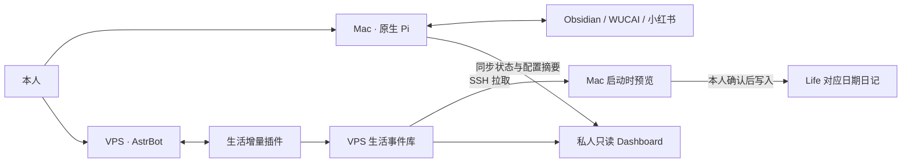

# Personal Asis 总规格

修订：2026-10-20。当前架构以本文件和 [ADR 0037](docs/adr/0037-use-two-agents-and-confirmed-daily-sync.md) 为准。旧 PA0–PA5／P0–P4 验收是日期快照，不定义本轮部署。

## 1. 分工

Mac 与 VPS 各自执行职责，均可在另一端不在线时使用。没有旧协调队列、跨节点模型综合、全库复制或替代 AstrBot 的自建模型循环。

## 2. Mac 知识 Agent

原生 Pi 管理模型、会话、shell／文件工具、资源与 MCP。Study／Life 按需读取；WUCAI 中国区使用既有缓存和官方 API；小红书复用现有回环 MCP 与 Keychain 会话。来源正文不在启动时加载整库，SQLite 是可选发现途径。Folo、知乎和公众号不加入本轮主线。

笔记写入前显示目标与改动，获得本次用户确认。平台写入通过窄 `source_write` 扩展：WUCAI 日记追加、页面笔记更新、文章状态；小红书点赞／取消、收藏／取消、发表评论。每次原生 UI 显示完整参数并确认，计划五分钟有效，执行前落盘一次占位。未知结果保留防重，不自动重试。不包含发布图文／视频、删平台文章、自动社交互动或后台抓取。

扩展不限制 Pi 的正常回答、检索、模型选择或上下文。原生 shell 不是受控 OS 沙箱，不能声称仅凭此扩展就封锁了绕过操作。原生 Pi／AstrBot 的费用各归原提供商，旧 Asis 预算并不覆盖；保留旧账本数值和未知请求标记。

## 3. VPS 生活 Agent

AstrBot 本体保留模型、渠道与会话；`astrbot_plugin_life_agent` 补充以下能力：

- 只收录指定平台、已绑定本人的私聊文本；按平台／发送人／消息 ID 去重，不导入历史聊天或附件。
- 原话独立保存，模型通过工具整理为日常、健康、准备睡觉、起床、时间事项。摘要注明可修正，不将推测自动确认为事实。
- 默认以消息接收时间归档；用户补记由模型显式提供带时区的所属时间。对应日期按 Asia/Shanghai 计算，跨日可修订。
- `/life` 查看状态，`/life list` 列近期记录，`/life delete ID` 删除 VPS 正文并产生删除标记。
- 明确的到期事项可通过既有本人渠道提醒。每15秒检查一次，发送前持久占位；平台返回成功／未知分别记账。服务崩溃留下的 `sending` 属待核对，不自动重发。不发送本轮测试消息。
- `life_context` 按需读取本人授权的初始化背景；与新消息、正式任务和提醒分开。`/life forget-context` 删除当前VPS背景及工作区说明，不声称撤回其他副本。
- `life_recent` 只读近期生活记录；`vps_workspace` 仅查看系统磁盘／时间、列出和读写生活工作区 Markdown 草稿。不给任意 shell、sudo、凭据、Mac 全库或其他项目权限。

VPS 可以持久保存本人发送的生活文本，这是本轮明确的数据驻留改变。目录0700、数据库／私密文件0600；不记录原话到项目日志。现有 AstrBot／平台自身历史遵循各自保留设置，不把插件删除报告为所有副本删除。

## 4. 启动同步

每次交互启动 `pi`／`scripts/asis-pi`，在原生会话前通过 SSH 固定导出接口拉取新增事件。不需要云模型，不把同步文本自动交给 Pi 模型。SSH 不可用时保留已有状态并继续 Pi；`--plain`、帮助／版本、工具管理、JSON／RPC／print 模式不启动交互确认。

目标来自已配置的 Life 根目录，日记相对目录 `Calendar/Journal/Daily`，文件 `YYYY-MM-DD.md`，区块 `## AstrBot 同步`。新增记录保留原话、可修正摘要、来源身份标记；修订替换该记录区块，日期改变则移至对应日期；删除只移除该事件区块，不删除日记或其他手记。

启动时先展示全部日期、文件与完整 diff。只有输入“确认写入”才执行整批；跳过的记录仍待同步。先复核批次文件未改变，再逐文件原子替换；已有内容改变、越界、符号链接、排除项均停止。同步锁防多进程，事件标记与本机收据防重复；中途失败可在下次重新预览，不能声称多个文件整体事务。Mac 本轮启动时没有预批准任何真实日记写入。

本机缓存与收据保存在忽略的私密 Pi 配置目录。删除在下一次成功拉取时覆盖本机待同步正文；离线 Mac、旧备份和平台副本需分别处理。每轮拉取有页数／大小／超时限制，超出留下一轮处理。

## 5. Dashboard

认证后的只读 PWA 展示最近100条 AstrBot 生活记录、事项和提醒状态；Mac 仅上传最近检查时间、待确认／已同步数量、四个来源是否已配置，不自动上传原笔记、根路径、密钥和会话。另支持用户明确选定的一份Mac摘要，通过 `source_write` 的 Dashboard 发布操作预览完整标题／正文并确认后才上传；看板显示最近一次确认的摘要，没有自动遍历笔记或累积全文。Mac 来源配置不等于账户实时可用，上次同步不等于实时在线。

复用现有 HTTPS 与已有本人登录密码的哈希；切换时清除旧会话。服务绑定 VPS loopback，由 nginx 转发。POST 仅用于登录／退出，检查 Origin／CSRF；API 不缓存，页面按文本渲染记录，旧 PWA service worker 缓存清除。Dashboard 无资料搜索、远程执行、授权变更或无确认写入入口。

## 6. 退役与保留

移除旧 `astrbot_plugin_personal_asis`、旧搜索 PWA、协调／Relay／worker、旧飞书卡片代码与相应 CLI／部署模板／测试／运维文档。保留可回退的服务器旧发布、数据库、凭据和平台配置；不触及无关 AstrBot 插件。Mac 旧轮询／隧道退出后不再连接退役接口。

旧本地 Core、检索、角色、语义模型、付费工作状态仍供显式兼容，不迁移真实会话与账本。原始资料和既有本机缓存保留。历史 ADR 与验证记录保留日期并注明已被新架构修订。

## 7. 验收

合成测试须覆盖消息去重、时区与补记、提醒未知防重、删除清理、拉取分页、同步跳过／确认／重复／中断、跨日期修订、目标越界／符号链接／并发变更、平台计划精确确认与防重、Dashboard 认证与无外部控制路由。

现场检查实际 SDK 注册、VPS 服务／旧服务下线、SSH 导出、Mac 启动入口和 MCP 工具目录。真实聊天、模型整理质量、到期消息投递、真实 Obsidian 写入与真实平台操作单独验收，禁止合成成功冒充现场完成。详见[状态](docs/project-status.md)与[验证记录](docs/validation/two-agent-20261020.json)。

## 8. 2026-10-20 内容初始化

用户本轮明确要求Codex读取对应资料并初始化两边，选择VPS最近30天。Life窗口为2026-09-21至2026-10-20；Mac可读取获准Study知识资料与现有阅读缓存，形成仅本机保存的知识／使用背景，原生Pi只按需读取其私密文件。VPS只接收所选生活摘要及相对出处，不接收Study、整库、Mac绝对路径或凭据。

背景保留自述、历史候选与暂定解释的区别，习惯模板／他人讲话／既有AI回答不归为用户事实。没有可靠截止时间的旧任务不自动启用提醒，初始化不产生待同步事件，原日记不改动。Dashboard可展示已初始化的生活背景，与后续消息列表分开。Codex本轮读取不自动为Pi新增云提供商许可。
