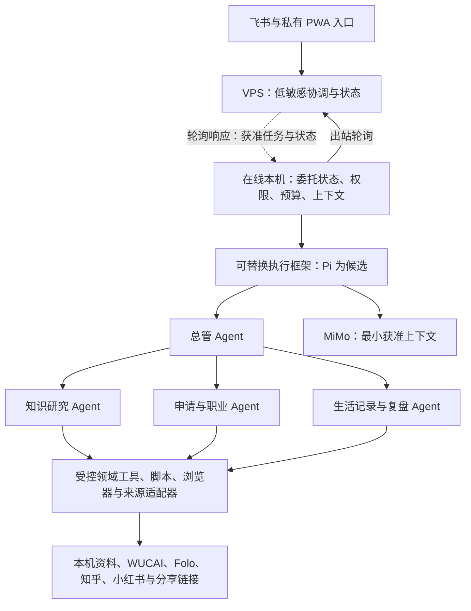

# Personal Agent 架构审阅稿

状态（2026-10-15）：整体架构共识已确认；PA0 已按 Mac 单节点范围完成验收，见 [最终结果](pa0-acceptance.md)。ROG 停用，独立备份／恢复密钥暂缓。MiMo 本机及本人渠道分析已交付；本机委托状态和 Pi 核心合成适配已通过 [第一切片验证](agent-runtime-local.md)。本机受控按需执行已通过 MiMo 实际闭环／恢复续验，见 [最新记录](agent-on-demand.md)；本人渠道 Agent 与持续委托尚未上线；后续路线见 [实施计划](implementation-plan.md)。详细依据见 [架构](agent-architecture.md)、[来源](information-sources.md)与[总规格](../SPECIFICATION.md)。

## 整体责任

我们构建并保有个人助手的业务权威：目标、持续委托、用户行动任务、资料政策、确认、预算、记忆规则和成果；Agent 执行框架通过适配接口负责模型与工具循环及可复用的运行机制。Pi 是优先验证候选，具体组件和版本由验证结果决定。

图中是职责与工作路径，不是已部署服务清单。模型调用在获准本机直接进行；VPS 不汇集个人全文，源码、私密资料和凭据保留原有边界。专业角色的协作请求由总管转派汇总，独立工作有限并行，同账号浏览器排队，合计预算控制全部角色调用。

## 委托、交互与连续性

- 持续工作独立于聊天管理，一项委托包含多次运行；角色保有确认过的领域目标和约束，工作记录按委托组织，执行时检索相关历史。
- 在明确的主题、资料与预算范围内自主规划、调整工具步骤和准备草稿；检查频率可在用户设定上下限内调整并展示理由，用户可覆盖。
- 主动长任务先返回理解、计划和状态，有证据后尽早给初步成果与缺口，再后台补全；普通后台成果集中汇总，需介入／到期风险／持续失败及时通知。
- 主动请求优先于普通后台工作并预留容量，明确到期事项按配置例外处理；任何优先级都不突破预算。
- “停止这项工作”默认暂停当前委托和子工作，保留成果，等待明确恢复；只停本轮、取消委托和删除资料分别处理。
- 离线／休眠等待原执行节点，恢复后从持久进度继续；首版不自动跨节点接管，不盲目重复结果未知的外部操作。

## 阅读输入与留存

| 来源 | 首版方向 |
|---|---|
| WUCAI | 官方读取接口，减少 Obsidian 中转维护 |
| Folo | 全部现有订阅按委托主题筛选，接入个人精选 |
| 知乎 | 官方 CLI，关注内容的实际覆盖待验证 |
| 小红书 | 指定 MCP；关键词搜索、分享、可见收藏与首页推荐 |
| 微信公众号 | 已有可用订阅、剪藏／收藏与分享链接，暂不自建全量更新抓取 |
| Obsidian／本机 Markdown | 可选资料入口，既有只读索引和私密 journal 政策保留 |

订阅发现与个人精选分别表示，保留出处、版本、获取完整性和到达渠道；作者原文、用户批注、用户手选与 Agent 代选不混同。个人精选尽量回溯可获取历史，订阅流主要增量获取，未精选正文缓存 30 天。

Agent 可按认可规则把部分正文加入本机精选，标注代选理由并可撤销。用户移除后，仍允许以后按规则再次选入；这不是永久排除或所有副本的删除，也不回写平台收藏。原来源删除或权限撤销仍须生效。

普通文章和非敏感批注可供 MiMo 按最小相关上下文分析。2026-10-14 用户确认[持续授权](private-data-authority.md)，覆盖 Study／Life 新增文件、获准提供商、本人渠道私密展示和有出处的自动记忆，见 [ADR 0033](adr/0033-use-standing-personal-data-and-maintenance-authorizations.md)。凭据和明确排除项优先，暂定解释不自动成为确定事实；相应能力按实际实现逐项验收。

## 能力与操作边界

领域工具、临时脚本、浏览器均经系统执行与披露检查。脚本在专用工作目录写成果，原始资料只读；本项目现有 Mac／VPS 的依赖安装、配置修改、测试后部署、已有服务重启与回滚已有持续授权；删除来源原文、扩展目标或预算等另行确认。浏览器可读明确授权的登录站点并准备内容，提交、发送、自动保存等远程写操作遵循具体确认。

成功脚本／流程可形成候选工具或技能版本，列出用途、依赖和调用关系、权限、验证及回退方式；经用户确认后注册，关键版本或权限变化重新审阅。注册不等于允许后续对外写操作。

## 实施前的明确留项

框架组件、运行接口、检查点、并行预算／排队、脚本隔离、缓存清理和检索机制由工程验证选择。知乎关注流、平台历史和正文覆盖、登录稳定性需要事实核验，不能用模拟测试宣布接入完成。

每项真实委托的主题、来源、频率、到期、预算、通知条件及代选规则，账号区域／凭据、获准站点、并行容量和备份目标，在部署切片配置；本稿不制造默认凭据或启用后台订阅。更改数据驻留、披露或权限的决策仍须明确记录。

PA0 已验收；Agent 上线继续按独立切片推进。[执行框架验证](agent-runtime-validation.md)已使用实际 Pi 核心、合成资料与模拟提供商核验第一批边界，真实 MiMo 工具兼容性另需有限调用验证。具体评估与候选组件不代表生产 Agent 已上线。
