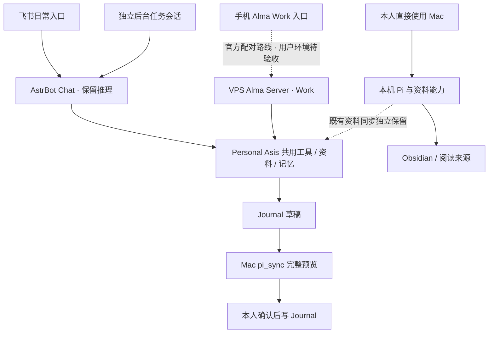

# Alma 与 Personal Asis：接入评估及 Chat／Work 协作提案

> 本文件保留早期研究过程。终版交付为 [Chat 计划](plans/2026-11-09-chat.md)、[Work 计划](plans/2026-11-09-work.md)及[共用选型与接口](plans/2026-11-09-shared.md)。后续以它们为准：Chat／Work 独立维护，PWA 保留；共享记忆采用成熟引擎试点，不执行本文早期的自建记忆核心建议。

日期：2026-11-09，Asia/Shanghai。性质：研究与设计讨论。下述边界以用户最新选择为准；架构尚未实现，现有生产分工保持原状。CONTEXT.md 仅维护标注为未部署的设计词汇。

## 结论

当前方向是 AstrBot 保留推理能力，负责飞书日常 Chat；Chat 只建议在 Work 模式执行，不创建或交办工作。用户在手机 Alma 自行开始面向 VPS 的 Work，Alma 不建立与 Mac 的连接；有 Mac 的场景由用户直接本地执行。优先共用工具、资料和跨会话记忆，不要求统一引擎或跨入口接续活动会话。Personal Asis 保留生活数据、资料来源、确认写入、同步与执行回执。

优先验证官方 Alma Server 作为 VPS Work 后端。官方 v0.4.139 已提供无桌面 Linux x64／arm64 服务及 iOS relay 配对路线，当前发布资产仍含 Server；先前“未找到无界面服务”的判断已修正。完整应用源码仍未核实公开，应区分“官方可部署产品”和“可自行修改的开源运行时”。暂不为这条路线另建 Pi 会话宿主，Pi／herdr 仅在现成 Work 能力不足时另行评估。[官方 Server 发布说明](https://github.com/yetone/alma-releases/releases/tag/v0.4.139)

Alma、AstrBot 和 Mac Pi 的共用工具与资料是本提案的集成目标，尚未实现。长期记忆按身份、来源与适用范围检索，Chat 不向 Work 交接当前上下文。iOS Alma → relay → VPS Alma Server 已有官方路线，用户 VPS 上的配对、工具能力和资源占用仍待实测；Android 与 Server 的具体兼容性尚未核实。

## 已明确的设计规则

- **Chat／Work 边界**：飞书不交办 Work，只提出适合在工作模式执行的建议。用户自行打开 Alma、发起工作；系统不能声称已经派发、启动或完成对应工作。
- **执行位置**：手机 Alma 的远程工作面向 VPS，不连接或控制 Mac，不新增 Mac 唤醒、排队或远程执行链路；有 Mac 时由用户自行在本地工作。所需材料仅在 Mac 原库而 VPS 没有获准副本时，远端说明本次无法取得。
- **上下文**：Chat 保留自己的聊天上下文及记忆，不向 Work 自动复制当前聊天、生成交接说明或创建工作。Work 仍可按需检索共用记忆与资料，不能将检索结果当成新指令。
- **记忆身份**：计划、推测、AI 建议保持各自身份；生活与学习事实依据本人明确自述，不从聊天气氛或任务材料推断。
- **自动记忆**：本人明确表达的稳定偏好和决定自动保存，提供查看、纠正和撤回入口，并随对话中的后续明确表达更新。计划、推测和 AI 建议继续保持各自身份，不自动提升为用户决定或已发生事实。
- **Mac 数据关系**：Alma 不连接 Mac 的限制不自动撤销既有 pi_sync 和共享资料授权。本次保留其独立流程，不据此新增实时 Mac 访问或把最近副本当成实时原库；新记忆如何供本机 Pi 使用需在能力层设计中落实。
- **实施前验证**：采用官方无 Mac 中继路线，核对实际手机平台、Server 配对、VPS 资源及工具／记忆接入；其余工程细节不改变上述用户选择。

## 证据范围与验证层级

- 工作区：`main`，检查点 `ecf6a39`；检查前工作区干净。读取现行规则、规格、词汇、状态、路由、共享检索、日记、日历和 Pi 启动代码。GitHub 仓库元数据另行读取；本地修复不能仅凭公开 README 判断。
- VPS：通过既有 SSH 只读读取本人绑定私聊的近期历史、路由调用元数据、部分配置及在线模块哈希。没有把聊天记录另存入本文或 Git。
- 服务检查时 AstrBot、Dashboard 均 active；Life 插件 2.11.2、Router 1.1.0。Router 四份核心在线模块与发布清单一致；原生摘要 Provider 为空，原生 `max_context_length=-1`。
- 当前安装的 Mac Pi 包是 `@earendil-works/pi-coding-agent` 1.2.0，MIT；已阅读其本地 RPC、SDK、扩展 UI 与重试说明，并核对官方上游。
- Alma：公开官网、官方功能及插件文档、GitHub 发布仓库。后续补查官方 v0.4.139 的 Alma Server 说明，并核对 v0.4.529 资产中仍有 Linux x64／arm64 Server 包。没有安装、运行或验收 Alma；未实测手机配对。
- herdr：读取官方文档和公开仓库。`herdr` 与 `herdr-core` 均可核验 Apache-2.0；两个项目不能视为同一个服务器实现。
- 本轮没有真实模型调用、平台发送、日历/日记写入、凭据迁移、依赖安装或服务变更。未执行迁移原型和性能测试。

## Alma 实际能替换什么

| 维度 | 当前 Personal Asis | Alma 公开能力 | 取舍 |
|---|---|---|---|
| 桌面对话与工作区 | Mac Pi 终端；Dashboard 展示生活与同步状态 | 多会话、模型选择、工具展示、工作区 | 优先使用现成 UI，减少自制通用聊天界面 |
| Agent 推理和工具循环 | Mac Pi、AstrBot 两套；Router 额外适配 AstrBot | Alma 自有聊天能力及 Linux Server，也可作为 herdr Agent 的 GUI | VPS 优先验证 Alma Server；保留 AstrBot Chat，不强制增加 Pi 后端 |
| 资料检索 | 本机索引、阅读库、共享 SQLite、WUCAI 实时读取 | MCP、工具、Skills | 抽取现有数据能力供多个入口调用 |
| 跨会话记忆 | 本人旧会话按需回查，背景与随记分别管理 | 官方描述自动提取、向量检索及可编辑记忆 | 适合体验借鉴；不能直接证明 Pi/飞书共享同一记忆 |
| 飞书渠道 | 已绑定本人私聊、附件、通知和生活采集 | 未核实可替换现有链路的官方飞书适配 | 暂留 AstrBot 渠道，新增功能放在渠道边缘 |
| Journal | 原话保留、归组编排、完整预览、确认写入、图片和恢复收据 | 通用文件工具 | 保留项目专用能力，新增语义精华草稿 |
| 日历 | 现成 Google Calendar MCP + 窄提案封装 | 可连接 MCP | 复用上游；重构自己的提案与执行层 |
| 后台持续运行 | VPS 服务独立于 Mac | Alma Server 可无桌面运行，官方说明支持 iOS relay | 手机远程工作只面向 VPS；实测资源及配对，不引入 Mac 中继 |
| 维护与可替换性 | 自有代码可控，但适配层较多 | 现成客户端更新方便；应用源码未核实公开 | 把 Alma 当可替换客户端；核心数据与能力保持独立 |

官方来源：[Alma 首页](https://alma.now/)、[发布仓库](https://github.com/yetone/alma-releases)、[会话](https://alma.now/docs/guide/threads)、[工具](https://alma.now/docs/features/tools)、[MCP](https://alma.now/docs/features/mcp)、[记忆](https://alma.now/docs/features/memory)。这些是产品与文档能力，不能当成用户环境中的实测结果。

## 聊天问题对应的真实边界

近期历史能确认：切模型要求曾只得到文风模仿；日记查询后的回答偏到了催睡操作；模型在没有诊断证据时断言 Router 没问题，又附和“gate 太多”就是根因。最后一种尤其说明回复可信度与 Critic 行为需要单独设计。

11 月 9 日代码已针对重复时间消息、当前轮识别、明确模型选择、双重压缩和旧会话回查进行修复，并在 VPS 核对在线配置。不能把修复前的历史直接认作修复后仍失败；也不能用 SDK 合成通过代替真人聊天质量验收。最新调用中的一次 Gemma 问候属于已有合成验收，不是本轮新调用或自然聊天性能证据。

另已核实一条额外的上下文混入路径：本人普通会话历史出现了 `Output your last task result below.`，随后是 `[CronJob]` 执行报告。VPS 实际安装源码中，`core/cron/manager.py:495–510` 构造报告并调用 `persist_agent_history`；`core/utils/history_saver.py:20–31` 读取目标会话历史，追加这条合成用户消息和助手报告，再更新会话。代码路径与实际历史相互印证。它不能证明此前每次串线均由此引起，但说明仅修复 Router 压缩仍不足以完成后台任务隔离。

`shared_store.py` 已经使用 SQLite FTS，问题不是“完全没有检索”。当前主要是精确短语/关键词检索，按来源标识排序，缺少面向“上周发生了什么”的日期枚举、覆盖说明及统一证据组织。换 UI 不会补齐这层能力。

现有系统还存在生活插件自己的提醒/简报与 AstrBot 原生定时任务两条路径。迁移前应盘点实际任务及归属，避免两边继续独立创建同用途任务；不能只迁生活 SQLite 就宣称定时功能已迁完。

## 十三个诉求的处理建议

| # | 诉求 | 当前证据/缺口 | 推荐落点 |
|---|---|---|---|
| 1 | 模型切换更智能 | Router 已修复明确单轮选择，但分类仍主要依赖规则，复杂任务仍可能因免费额度退回 Lite | 共用模型策略；显示实际模型和降级原因；优先稳定质量，免费路由作为可选档 |
| 2 | 上下文清晰 | 已关闭本人 Router 的原生摘要与截断；后台任务内容仍出现在聊天历史 | 会话引擎单独负责压缩，后台任务使用独立会话，显示材料覆盖与压缩边界 |
| 3 | 智能访问数据库 | 共享 FTS 和多个工具已存在；面向日期范围的资料发现较弱 | 提供统一搜索、按日期枚举、分页原文和来源覆盖接口；先补确定查询，再评估语义检索 |
| 4 | 不同对话间记忆 | 已能只读回查；不等于长期个人记忆 | 保留各会话隔离；另存带来源、状态、时间和撤回记录的长期记忆 |
| 5 | Critic | 对技术归因有无证据附和行为 | 默认诚实指出不确定性；决策时按需进行一次结构化反方检查，无须常驻第二 Agent |
| 6 | 语义整理、精华入 Journal | 现行编排刻意保留原话，不让模型重写 | 保留原话轨，另加精华草稿轨；区分用户自述、AI建议、共同结论，完整预览后确认写入 |
| 7 | Unicode Emoji | 模型身份 Emoji 已有；不代表 `[捂脸]` 等已归一 | 飞书展示层使用小范围明确映射，避开代码、引用和原始存储 |
| 8 | 日历批量及自然确认 | 当前待确认字典最多一项，第二项返回 `pending_calendar_confirmation_exists` | 持久化批次、分项选择、明确确认、逐项执行及回执；未知项核对后再续办 |
| 9 | AI Trajectory | 有模型用量表及聊天，但没有贯通的问题—决策—工具—成果轨迹 | 从引擎事件生成可回看的使用轨迹，保留引用/修改/采纳情况；不采集隐藏思维链 |
| 10 | GUI / 飞书 Card 切会话 | Alma 有多会话；飞书单聊仍需内部会话映射 | Alma 复用现成会话 UI；飞书卡显示会话名、运行位置、模型、状态和切换操作 |
| 11 | 输入 `/` 弹命令 | 旧回复把文档编辑器斜杠菜单类推到机器人，缺少依据 | 优先机器人固定菜单；发送 `/`/帮助后回命令卡。输入框实时补全须另验客户端能力 |
| 12 | 收到消息贴表情 | 飞书官方提供消息 reaction API | 在接收、处理、待确认和失败阶段映射 reaction，平台支持的表情类型与正文 Unicode 分开处理 |
| 13 | 任意链接剪藏 | 五彩已支持按需读保存全文；VPS 封装仍是读取，未包含通用新链接剪藏 | Agent Reach 等负责获取；五彩负责保存。先区分“读这个”和“收藏这个”，保存后回查实际正文 |

飞书依据：[机器人概述](https://open.feishu.cn/document/client-docs/bot-v3/bot-overview?from=home)、[消息与 reaction API](https://open.feishu.cn/document/uAjLw4CM/ukTMukTMukTM/reference/im-v1)。菜单、卡片和 reaction 仍需核对现有适配器、应用权限及回调方式，本轮未做平台交互测试。

## 共享范围与独立会话

1. **共用工具与资料**：复用知识检索、生活记录、记忆查询、日历提案、Journal 草稿等业务能力；原始资料所有权、来源范围与写入规则保持明确。
2. **共用跨会话记忆**：共享经来源和身份区分的个人信息；当前有效版本用于回答，支持用户查看、纠正、撤回及新对话中的更新。
3. **各自管理会话与引擎**：AstrBot 管 Chat；用户在 Alma 面向 VPS 主动开始 Work，在 Mac 自行本地工作。Chat／Work 不自动交接任务或当前上下文，不建设跨入口工作派发路径。

共享资料或长期记忆不等于共享实时会话或复制全部密钥。Mac 是否在线不影响飞书 Chat；手机远端 Work 只使用 VPS 的既有或获准能力，不等待或远程唤醒 Mac 执行工作。

## 推荐分工与通信

图中是建议目标，不代表当前已经有通用 MCP／记忆层或用户 VPS 上的已验收配对。Chat 与 Work 没有自动交办箭头，Alma 与 Mac 没有控制连接；既有 Mac 资料同步单独保留。iOS 官方配对可用性与 Android 兼容性分别核验，不把 Server 的全部工具等同桌面版。

### AstrBot

继续处理飞书鉴权、本人绑定、消息和附件、自然交流及按需调用共用工具。遇到需要持续执行、复杂操作或正式交付的内容，可以建议本人切到 Work，但不创建、转交或启动工作，不生成上下文交接包；本人在 Alma 自行开始。

生活原话应先可靠保存，再调用引擎；引擎失败不丢记录。提醒和简报按已核对的归属运行，后台执行会话与 Chat 分离。保留 AstrBot 推理，不预设最终移除。Chat 推荐切 Work 的条件应克制，避免把日常资料查询和正常讨论都推给另一入口。

### Mac Pi

保持 Obsidian、WUCAI、小红书本机访问和已确认写入工具；由本人直接本地使用，不建立 Alma 到 Mac 的连接。既有 profile、启动包装及 pi_sync 独立保留。复用工具与记忆规则，不复制本机 Keychain 或整库到 VPS。

### Personal Asis

把已有 `life_store`、`shared_store`、`conversation_memory`、WUCAI、日历提案与日记草稿能力从 AstrBot 的 Event 对象依赖中抽出。内部业务函数继续复用，外面加小型 MCP/本地进程适配，避免每个客户端重写一份实现。

MCP 是模型调用工具的协议，运行控制另用 Pi RPC/SDK。每次工具调用的身份由可信连接绑定，不能相信模型自行填写的 owner、节点或权限；Mac 专属写入最终仍在 Mac 预览并确认。Alma 的 MCP 文档支持对必须完整保留的工具输出声明 `alma/outputSafetyMode=exact`，适用于来源正文、版本和预览；它不能代替权限检查。[官方说明](https://alma.now/docs/features/mcp)

### 模型与上下文

先提供三个可见档位：日常、深入、指定模型。深入任务使用能力足够的既有模型；如果仍选择免费优先，降级应可见。用户点名的模型失败就明确报告，不以仿写冒充切换。模型标记来自真实发送回执，不由模型自己宣称。

每个会话由其所属引擎负责工具循环与工作上下文；业务层负责来源筛选、明确记忆和提案。同一会话避免多层重复压缩，AstrBot Chat 与 Alma Server Work 分别维护自己的上下文。保留现有 Router 对 Chat 的额度预占、冷却和失败区分；不预设它可以直接接管 Alma Server 的模型请求。

对 Alma Server 验证重试、工具确认与执行结果不明时的行为；官方提供 `ALMA_TOOL_APPROVAL`，不采用全自动允许来绕过现有写入确认。若以后引入 Pi，其本地文档显示默认有 agent 级自动重试，也需审查。成熟框架的默认行为不必然符合本项目约定。

## 手机 Alma 到 VPS 的路线

| 路线 | 能得到什么 | 主要限制 | 建议 |
|---|---|---|---|
| 手机 Alma + VPS Alma Server | 官方提供 iOS 经 relay 访问无桌面 Linux Server 的路线 | 用户 VPS 配对、资源、工具和共享记忆接入待验收；Android 支持需单独核对 | 首选，无须 Mac 中继或飞书工作交办服务 |
| Alma Server + Personal Asis 共用能力 | 复用现成 Work 界面与引擎，并连接个人工具及资料 | Server 实际 MCP／插件能力和记忆读写接口需实测，不能仅凭桌面文档保证 | 先接少量只读工具，再验证记忆与受控写入 |
| Alma + herdr／Pi | 扩展终端 Agent 工作场景 | 手机→Server→herdr→Pi 全链路和资源待验证，不是当前首选路线的前置条件 | 有具体能力缺口时再引入 |

不能把 Alma 的 Custom Provider 当成“暴露 Alma Agent 后台”。该能力让 Alma调用模型接口；把完整 Pi Agent 伪装成模型可能让双方各自维护工具循环和上下文。[Custom Provider](https://alma.now/docs/providers/custom)、[插件 API](https://alma.now/docs/plugins/api-reference)

手机到 Server 的官方路线与 herdr／Pi 的展示集成应分别验证。官方 v0.4.529 发布资产含约 200 MiB 的 Linux Server 压缩包，该大小不代表运行内存。v0.4.139 说明 Server 不启用 Computer Use 或活动记录，因此不能把桌面自动化能力直接代入 VPS。[Server 说明](https://github.com/yetone/alma-releases/releases/tag/v0.4.139)、[当前发布](https://github.com/yetone/alma-releases/releases/tag/v0.4.529)

## 共用能力与记忆的最低契约

以下是拟议逻辑字段，不是现有 API：

| 对象 | 最低字段与约束 |
|---|---|
| 身份 | 可信入口绑定本人身份与能力范围；不能接受模型自行填写身份扩大权限 |
| 工具 | 复用同一业务定义，保留调用 ID、来源版本和结果状态；成功/拒绝/失败/未知分别报告 |
| 资料 | 保留来源所有者、取得时间、版本及读取覆盖；过期副本与实时资料分开 |
| 记忆 | 内容身份、适用范围、原始依据、有效时间和版本；按当前有效状态检索，支持查看/纠正/撤回 |
| 提案 | `proposal_id`、版本/摘要哈希、目标变更、确认人及有效期；修改内容后旧确认失效 |
| 轨迹 | 各引擎可取得的可见消息、工具、来源、模型、成果与用户采纳/纠正；不把隐藏推理当作轨迹 |

不建设 Chat→Work 派发、回调通知或当前上下文搬运服务；Work 沿用自身引擎已有的会话和任务状态。共享层只承担有明确价值的个人业务能力，不再为不同界面重造一套完整运行时。

本机 Pi 的平台写入继续沿用原生确认；Alma Server 的共享写工具也需展示明确目标和本次变更，再取得本人确认。手机配对或自动保存明确偏好的许可不扩大日记、日历或平台写入范围。

## 记忆、Journal 与 Critic 的具体设计

**记忆分层**：当前会话由引擎维护；旧会话按需检索；长期记忆保存明确偏好/事实/决定及来源；正式 Journal 保留本人确认的版本。本人明确表达的稳定偏好和决定自动保存、可查看、纠正及撤回，并随后续明确表达更新。计划、推测、AI 建议保持各自身份；生活与学习事实依据本人明确自述，不从聊天气氛或任务材料推断。工作进度及完成状态仍以工作执行回执为准。

**更新语义（建议实现）**：自动更新依据内容性质与适用范围，不能简单采用“最后一句覆盖全部”。同一范围内的明确偏好变更将旧版本标为已被替代；“这次简短一点”只影响本次任务。计划撤销更新计划状态，不能改成已经完成。新旧表达冲突且无法确定是在纠正还是描述不同时期时，只澄清该条，不阻塞正常聊天。更新保留来源与修订关系，原始聊天不被覆盖；撤回的记忆停止检索并向副本传播撤回状态，避免旧缓存使其重新出现。

Alma 的记忆文档说明了自动提取与检索，但没有证明其原生记忆会用于外部 Pi。即使三端能连接同一记忆 MCP，Alma 自己的自动记忆仍可能构成第二套来源。试用时先限定为非权威辅助，或关闭重叠自动记忆；语义向量若使用新提供商，应单独处理资料范围及授权，优先现有本地能力。

**Journal 双轨**：`/life` 继续保有原话；用户选择的对话段落或一天候选生成“精华草稿”，做去噪、主题归并、关键推敲与下一步总结。每条保留来源消息关系，AI 提出的建议与用户已采纳结论分开，不能用 AI 的鼓励话自动填成用户生活感悟。Mac 合并当天手记并显示完整改动，保持现行确认写入。这样改变的是派生草稿能力，不牺牲原话或覆盖手写内容。

现有“机械搬运”有一部分是原话不可改写的明确产品选择，不全是模型不聪明。新诉求要求增加语义整理轨，而不是继续往原话编排校验器里堆改写能力。

**Critic**：默认不讨好、不无证据归因；当讨论重大选择、反复犹豫或用户明确要求时，输出目标、核心假设、最强反对意见、支持/反对证据、可验证的小行动。批评对准推理与选择，不对人格下结论。先用同一引擎的一份角色资源/一次审阅；只有实际质量不足才增加第二次独立模型审阅。Critic 不获得额外写权限，也不应把日常交流全部变成审判。

## 日历批次与链接保存

当前日历队列阻塞是明确实现限制：`calendar_pending` 在内存中，允许一个未过期提案，服务重启即清空。建议业务层改为持久批次，不让等待确认占用整段 Agent 运行。

同一批次展示每项日历、标题、时间/时区和具体变化；支持选择部分项目、修改、取消、确认。卡片按钮或“确认刚才这三项”只有在本人、当前显示批次及版本唯一匹配时才有效；多个批次时先让用户选择。后台普通聊天继续运行。Google 事件不具备整个批次的原子事务，必须逐项显示成功、未执行、拒绝、未知；未知项先只读核对，不整体重放，也不自动回滚成功事件。

链接流程建议是：明确读取/收藏意图 → 精确 URL 查询已有五彩条目 → 已有保存正文则完整分页读取 → 未保存时按平台能力抓取或给出保存提案 → 用户确认后保存 → 回查状态与实际取得正文。Agent Reach 是获取工具集合，不代替五彩保存和个人资料管理；登录、反爬、图片、视频及保存版本差异使“任意链接必有全文”不可承诺。当前 VPS 五彩封装只有读取，不能当成已具备新增剪藏写入；新写能力应先验证官方接口及对应确认路径。

## 迁移顺序与停止条件

### 第一阶段：验证手机到 VPS Alma Server

- 核对实际手机平台，采用固定版本官方 Linux Alma Server，在不接入 Mac 的条件下验证配对和基本 Work 能力。
- 实测启动与运行内存、消息、工具、取消、确认和数据位置；不导入整库聊天或扩大凭据用途。
- 先验证 Server 自带能力，暂不额外增加 Pi／herdr 常驻组件；无界面下的浏览器及来源获取能力单独核对。

### 第二阶段：共用工具、资料和记忆

- 从生活插件抽出少量复用接口，先接只读检索、来源读取和记忆查询；验证 Server 的实际接入方式。
- 加入明确偏好和决定的自动记忆、按范围更新、查看、纠正与撤回。验证重复消息不重复生成，AI 建议不成为本人决定，撤回后各入口停止检索。
- AstrBot 保留日常 Chat；只建议用户自行开始 Work，不交办工作、不传递当前上下文。旧聊天可回查，不把已压缩损失的历史假装恢复。
- 定时任务使用独立会话，结果以事件/通知进入飞书；不将合成“用户消息”塞回日常会话。

### 第三阶段：迁移个人能力并减少维护面

- 依次加入 Critic、记忆候选、Journal 精华、日历批次与 Trajectory。正文 Emoji、菜单和 reaction 可作为独立小改动提前完成。
- 每搬走一条业务链，停止旧路径再启用新路径，保留原始数据及未决执行回执；尤其盘点两套提醒/定时任务和未知状态。
- 保留 AstrBot Chat 与 Alma Work 各自的推理能力；退出的是重复业务实现和同一会话中的重复压缩/执行路径。复用 Alma 通用工作 UI，保留专门生活 Dashboard；本机 Pi 继续独立使用。

继续条件：Mac 离线时飞书和已验证的手机远端 Work 不依赖它；Chat 不派发工作或自动搬运上下文；共享记忆可更新和撤回、内容身份不混；重复操作不双执行；写入确认可拒绝；未知结果不会触发重发；原话和日记不丢失。未通过时回退新增代码／配置，不用旧数据库覆盖新增记录。

VPS 检查快照约 0.94 GiB RAM、0.32 GiB 可用，并已使用 swap；只作该时刻容量参考。应先测 Alma Server 与既有 AstrBot 共存时的实际内存再决定并发；不把压缩包大小当成内存需求，也不同时增加 Pi、浏览器和新向量库。

## 建议的第一批工作范围

优先验证 **手机 Alma → VPS Alma Server** 的官方配对路线及资源；随后推进 **共用资料工具与可更新、可撤回的记忆**。Chat／Work 保持独立，无任务交办或当前上下文交接；Mac 本地工作由本人直接执行，既有资料同步保持独立。

本次已记录用户最新四项选择、修正 Server 支持判断，并同步未部署的领域词汇；没有安装或运行 Alma Server，没有改变线上服务、实际记忆库、日记或日历。生产实施时再同步运行规则、规格与状态。
