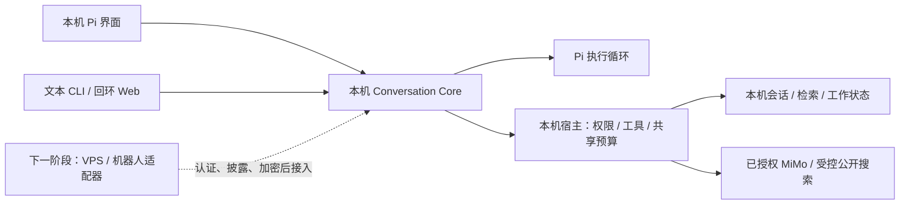

# 当前主线：本机 Pi Agent

2026-10-20 用户调整项目顺序：先完成可日常使用的本机 Pi Agent；VPS 连接、远程通信与机器人交互归档隔离，作为下一阶段。本文是当前开发范围；旧 PA0–PA5 验收和 P0–P4 历史记录保留原日期，远程接入不再是本机交付前置条件。

## 当前边界



本机优先指执行与状态权威在 Mac；MiMo 和明确批准的公开检索仍可由 Mac 直接调用，不要求全离线推理，也不经 VPS。Study／Life 原有来源和模型许可、凭据存储、共享账本、排除项及未知调用不重试继续有效。

| 层 | 当前范围 |
|---|---|
| Pi 界面／文本 CLI | 默认入口；持续聊天、会话切换、恢复、工具确认与清除 |
| Conversation Core | Session／Turn／Run、历史选择、工具执行、来源失效和付费防重 |
| 本机宿主 | 检索、获准阅读缓存、受控公开研究、明确的一次专业工作、共享预算与披露策略 |
| 回环 Web Chat | 本机辅助客户端；不要求 VPS、反向代理、隧道或平台身份 |
| VPS／PWA／AstrBot／飞书／Relay | 保留兼容实现与历史材料，冻结新接线、联调与部署，见[归档清单](archive/remote-communications-20261020.md) |

## 解耦约束

- 依赖方向为客户端／远程适配器 → Core → 宿主能力；Core 不导入协调器、机器人 SDK、Relay、轮询器或远程服务安装器。
- 统一 CLI 只在明确选择旧远程命令时加载相应模块。本机命令不读取 `coordinator.json`、不启动轮询、不建立隧道；机器上留有旧连接配置也不影响本机运行。
- 证据披露政策位于 `disclosure.py`，由本机宿主管理；远程适配器复用它。旧 `analysis_channel.validate_result` 导入兼容，避免破坏既有付费恢复及渠道协议。
- 远程代码按职责原位冻结，不搬迁运行状态、不删除历史实现、不重写原付费协议。归档是开发与依赖边界，不表示已经停服或撤销渠道授权；本轮没有操作现有 Mac／VPS 服务。

## 接下来先做什么

按以下顺序交付；前四项形成可日常使用的本机 Agent，持续后台工作单独验收。

| 顺序 | 要完成的切片 | 验收结果 |
|---|---|---|
| 1 | 统一日常入口、配置诊断和原生 Pi 使用体验，处理连续追问、会话切换、退出重开、工具确认／拒绝、取消与失败回执 | 使用 checkout 的当前引擎完成一组连续真实场景；明确原生 UI、Core 与固定旧发布入口的版本。中断与未知调用不重复付费；原生 Pi 真人验收单独记录 |
| 2 | 建立真实获准问题的质量集，修复检索充分性、日期／作者归属、回答忠实性、缺信息拒答和冲突处理 | 每题可回到原文核查；没有证据时明确不足，日记中的计划不写成已完成。样本与个人正文保留本机，Git 只存脱敏计数；检索替换仍过完整质量 Gate |
| 3 | 长会话有界摘要、较早历史召回，再分片实现可查看／修正／删除的长期记忆 | 超出当前四轮／2800字节上下文后仍能解释取用了哪些历史；摘要和记忆保留出处、时间与暂定状态。来源撤权／删除可使其失效；模型推断不自动成为事实 |
| 4 | 完善可审查的工具执行闭环：明确工作范围、进度、失败降级、成果保存与恢复 | 一次有界工作能交付带来源的本机成果，步骤和费用可追溯；失败可判断能否恢复。新增文件／脚本／浏览器能力逐项限定工作区、工具权限与确认范围，不直接开放任意执行 |
| 5 | 按需求完善本机 Web 和真实文本流式；持续工作执行器另立切片 | 流式建立在真实 Model Adapter 增量上；后台运行先有逐委托硬预算、期限、暂停／取消、撤权联动和本机通知。现有授权策略记录不会自行运行 |

第一步优先做“本机日常使用与质量验收”，用真实使用结果决定下一项修复，避免只以合成测试数量代表产品已经做好。此前已实现的对话、工具、状态与防重基础继续复用。

旧 P0／P1 对应本机聊天与工具，P2 保留本机 API／Web；P3 仍是未完成的有限持续工作；P4 全部转入[下一阶段远程计划](remote-communications-plan.md)。本机完成不以 P3 执行器或 P4 远程交付为条件。

## 开发与验收

```sh
scripts/asis-pi --check
scripts/asis-pi
scripts/asis chat
scripts/asis web-chat
scripts/test-local-agent
```

`scripts/test-local-agent` 在导入与执行期间禁止 VPS／机器人／Relay 模块，运行 Pi／Core／工具／工作状态合成回归；可选 Pi 未安装会明确跳过相应检查。测试用临时合成来源和模拟 Provider，不连接真实平台或消耗真实模型预算；回环 Web 测试需要允许本机监听。

全量 `PYTHONPATH=src python3 -m unittest discover -s tests -v` 仍可用于兼容回归；旧远程测试、VPS 解释器和平台 UI 不作为本机日常验收依赖。详见[本轮验证](validation/local-agent-isolation-20261020.json)。

推送前复核（2026-10-20）：修复本机 Web 初始化时的元素定位错误，新增无网络合成 DOM 检查；这是客户端冒烟验证，不能代替真人浏览器或原生 Pi 验收。最新结果见[Git 同步验证](validation/local-agent-git-sync-20261020.json)。
