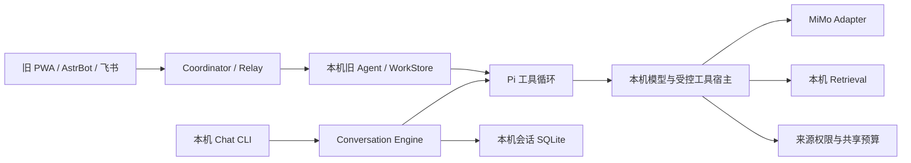

# Local-first Conversational Agent 路线

2026-10-19，当前产品定位为 **Local-first、Channel-agnostic、Conversation-first Personal Agent**。P0及本轮P1仅修改checkout，不部署、不重启Mac／VPS／AstrBot，不增加预算、来源或后台工作。PA0–PA5保留业务能力编号及原验收事实；下列P0–P4是产品体验与核心能力的实施顺序。

## 审计基线与实际依赖

开始时为`main`，HEAD `a56cdd1`；最近提交依次为`a56cdd1`、`32027fe`、`57f4325`、`f1aec1a`、`b5d2d25`。已有未提交Pi终端／周复盘修复，包括`agent.py`、`pi_terminal.py`、`local_review.py`、Pi UI、相关测试与文档，本轮保留。部署版本未在本轮切换，旧日期段落是历史快照。

| 模块 | 实际职责及依赖 | 最小迁移 |
|---|---|---|
| `agent.py` | 本机AgentHost依赖PA1、WorkStore、模型、检索和Pi适配器；没有导入AstrBot、飞书、Relay或Coordinator。`execute`每次建立工作／运行，按mode决定bootstrap和角色 | 保留旧执行与恢复；新聊天独立编排，不改已付费输入 |
| `agent_model.py` / `model_provider.py` | MiMo非流式HTTP、工具消息转换、输出校验；凭据在本机 | 新聊天复用凭据／HTTP／工具回复转换，以独立version约束新payload；`chat-json-actions-v1`用JSON动作转为Pi工具事件，不依赖供应商原生function选择 |
| `runtime/pi/bridge.mjs` / `runtime_adapter.py` | Pi 1.2.0只维护本次模型／工具循环，Python处理所有模型请求；无密钥、默认编码工具和业务权威 | 原样复用；真实文本streaming尚无，现有事件为步骤start/done |
| `request_intent.py` | 旧路径用窄关键词识别本轮支持性回应；明确禁止历史与工具 | 保留旧语义。新Session通过新系统提示与模型工具选择，不复用其路由；复用纯对话输出校验 |
| `agent_roles.py` | 关键词／显式mode路由，bootstrap后串行专业判断、总管汇总 | 新聊天不默认进入；领域目标、专业历史和旧接口保留，按需升级在P1接入 |
| `work.py` | 委托、运行、租约／fencing、执行资源锁、持久动作、控制与清理 | 继续作为Delegation权威；会话不是委托，不为闲聊建立WorkStore记录 |
| `retrieval.py` | 当前生产文档融合、单行证据、模型来源过滤及原文版本／位置重核；V2质量实验独立 | 新聊天按模型需要调用已有lexical baseline，不预热语义模型；检索协议替换仍须原质量Gate |
| `research.py` / `agent_web.py` | 已有Exa／Jina公开读取及v1/v2/v3受控研究；v3公开路径Host预检索以保证实际搜索 | P0预留公开工具接点，聊天不自动调用。P1以独立协议接入白名单query／SSRF／网络成本；不能把私人问题直接当公开词 |
| `conversation.py` / `chat_cli.py` | 新增持久Session／Turn／Run、有限上下文、共享预算、防重、来源失效与单主Agent；CLI只做输入、展示、控制 | 新增核心及简单文本客户端；后续本轮接线已使原生Pi默认调用同一Core，无目录搬迁 |
| `agent_channel.py` | Relay及本机Worker；Worker在Mac调用`agent.execute`，Relay管理短期加密投递／低敏感状态 | 旧接口保留；P2/P4再用Session API接线，不让Relay规划 |
| `agent_feishu.py` | 核对本人绑定、平台事件防重、临时密钥及加密回复转换 | 继续适配旧工作接口 |
| Coordinator / PWA | 本机出站轮询；PWA表单提交已有分析／Agent工作，服务器不持有本机正文和密钥 | P2新增聊天页／Session API，当前不伪装已改版 |
| AstrBot插件 / Feishu Cards | 插件身份／命令／回调／投递；卡片会话存表单及动作身份，不是核心对话历史。插件不定义模型工具选择 | 本轮不改；P4转换到同一Core API |
| `cli.py` / 旧Pi终端 | CLI已有agent run/resume/status、work、PA1、检索和研究；原Pi终端存工作引用，普通conversation仅看本轮、资料追问最多两项 | 新增`chat`命令；`asis-pi`及旧模式继续可用 |

因此原核心并未完全依附AstrBot。主要耦合是：单次工作生命周期被用来承载聊天；旧角色路由／强制bootstrap；旧普通回应不能看会话历史；旧跨渠道请求结构围绕source/mode/target_id，而非Session。

未来Web/PWA和远程渠道经身份与披露检查调用同一Conversation API；VPS远程可达不改变本机资料与状态权威。核心不能反向依赖卡片、平台SDK或VPS。

## 交互与职责

用户消息 → 恢复Session → 选择必要历史 → 主模型直接回答或自主调用`search_notes` → 有限工具循环 → 回答／引用校验 → 落盘该Turn。普通解释不预先检索、不创建专业角色子运行；用户无需指定request_id、mode或source。

Conversation Session保持交流连续性；Turn绑定一次用户输入及回复；Run绑定这轮的执行与计费步骤。会话内的“记得”只表示选入的本会话上下文，不是长期事实。Work Delegation是独立的明确委托，范围、周期、到期、预算和通知条件需要另行定义；新Chat目前不自动升级或建立委托。三个专业角色及其目标／历史作为后续按需能力，旧入口继续可用。

## P0 核心API与状态

Python API在`personal_asis.conversation`：

- `ConversationStore.create()`、`sessions()`：创建／列出会话；`send(home, session_id, message, turn_id=...)`：发送一轮。省略turn_id时由本机生成；客户端重发须保留原ID。
- `inspect(home, session_id, turn_id=None)`：本机状态和已验证回复；`send(..., turn_id=..., resume=True)`：显式恢复。
- `cancel(home, session_id, turn_id)`、`ConversationStore.forget()`：取消未完成轮次／清除内容。正在运行的进程需先中断；另进程控制遇会话锁返回busy。
- `on_event`复用规范化`kind=model|tool, phase=start|done`，模型含turn、工具含name。CLI只显示有限步骤信息，不打印原始工具正文或payload。这是步骤通知，不是真实文本增量，也不是持久SSE日志。

不新增HTTP服务。P2需在认证／Origin／CSRF、来源模型及渠道披露核验后封装这些API，不能把本机函数直接暴露公网。跨渠道身份映射、远程授权管理和持久事件游标仍未交付。

新库`conversation.sqlite3`保存消息、步骤与最小证据，文件0600；每个Session用本机非阻塞进程锁防并发。`running`表示已创建执行；`interrupted`可显式恢复已提交步骤；`failed`不能自动重做；`completed`按同ID返回缓存；`cancelled`不能恢复；`expired/invalidated/forgotten`仅保留防重标记。进程崩溃留下running时，必须显式恢复，账本仍会阻断未提交的已付费或未知结果。未知调用保留预算预留；已知格式失败保留实际计费，不自动重试。Ctrl-C不能撤销已发出的请求。

## 上下文、来源与预算

- 每会话最多128轮；选择最近最多4轮已完成消息对，总历史最多2800 UTF-8字节；较大的单轮不会偷偷截断为完整历史。每次模型步骤还可确定性移除最老历史对以满足原max_prompt_bytes。CLI提示历史选择／裁剪，原提示及生成上限不增加。
- 当前没有付费摘要、跨会话历史召回或自动长期记忆。P1/P2增加按问题召回与可失效摘要，摘要必须保留来源和暂定标记；不得无限追加全文。
- 工具结果保存在步骤中，消息历史只使用用户消息及回答；旧引用编号从历史上下文移除，本轮引用只用本轮工具Evidence。每次检索最多3条，每段最多160字，总Evidence最多6条。保留原文位置／版本、敏感性及阅读出处。
- 历史依赖记录Turn ID。显示、缓存复用、恢复、模型调用与维护清理均核查证据；来源撤权／删除／版本变化会清除该轮及所有传递依赖轮次的内容。必要计费、防重ID保留，不能声称已撤回第三方历史副本。
- 模型与工具结果继续视作不可信内容；模型只能调用声明中的`search_notes`，宿主严格核查参数、已提交工具请求、来源许可和证据版本，不能因内容指令改变权限。
- 每轮最多4次模型、2次检索；新步骤启动时检查180秒运行时限，单次MiMo请求另受60秒timeout约束；在途网络调用可能超过剩余运行时间，返回后不得继续新步骤。没有后台执行。
- 所有新旧路径共用`pa1.sqlite3`日100,000／月1,000,000 Token（以原配置为准），先预留再调用，80%提示；不会新增预算。普通回答通常1次模型、0检索。凭据仍在Mac钥匙串，不进入Pi或仓库。
- `conversation-v1`及模型子协议`chat-json-actions-v1`与旧Agent／agent-web协议隔离；模型以显式JSON动作选择工具，宿主转换为Pi调用；JSON字段顺序原样持久化，模型payload逐步指纹核对。新协议／工具版本改变不能重算旧已付费步骤，须注册新版本并保留旧恢复实现。

## 兼容、ADR与回退

[ADR 0035](adr/0035-prefer-local-conversations-and-opt-in-specialists.md)明确修订[0022](adr/0022-organize-agents-as-a-supervisor-and-persistent-specialists.md)的默认多角色组织，限定[0025](adr/0025-route-specialist-collaboration-through-the-supervisor.md)只适用于实际专业协作；保留0019运行时边界、0021会话／委托分离、0026本机恢复、0029专业上下文以及0034付费序列化。原ADR正文与历史验收不覆盖。

旧`work.sqlite3`、`terminal.sqlite3`和已付费Agent会话不迁移、不导入普通Chat，不重新生成答案。`asis-pi --engine legacy --continue`恢复旧工作引用；`asis chat --continue`仅恢复conversation-v1。旧ID在新API返回找不到，不猜测转换；未来需要显式版本化导入器且逐条核对许可、TTL及引用。新版本未知时拒绝自动迁移。回退只需停止新Chat、回到原命令／代码；新会话库留在本机，原状态和账本保留，不能删除账本规避防重。没有本轮生产发布或服务回滚动作。

## 开发、验收与下一阶段

| 里程碑 | 范围与门槛 |
|---|---|
| P0 | 架构审计＋本机完整响应聊天、持久Session与有限历史、按需个人工具、恢复／预算／撤权、旧接口回归。先合成单测、实际Pi、隔离真实MiMo合成TTY，再由用户在checkout体验；不为每个核心变化做VPS联调 |
| P1 | 版本化Tool Registry、公开query披露边界、复用Exa/Jina／已有SSRF及网络成本、语义／时间／归属质量、有限补查、显式委托升级与按需专业能力；WUCAI/Folo/小红书按既有只读及模型许可接入。知乎／公众号不因旧计划重新推进 |
| P2 | 有界摘要／历史召回、稳定Session HTTP API、取消语义、事件持久化／SSE及真实文本增量，PWA默认Chat；高级设置容纳来源／模型／角色；先本机浏览器验收 |
| P3 | 权限内持续委托：主题／来源／频率／期限／预算／通知条件／暂停取消，使用WorkStore，不从一般资料授权推断后台许可 |
| P4 | VPS／AstrBot／飞书适配同一API，渠道加密／绑定／可靠性验收；最后独立发布，保留已验证回退 |

P0测试必须包括连续无需检索聊天、至少三轮指代、个人检索、工具失败、中断恢复、撤权及内容失效、重复请求0新增付费、脱离AstrBot执行，以及旧PWA／Feishu合成回归。真实模型联调使用隔离合成资料、原钥匙串及共享真实账本，只输出脱敏计数。真实个人回答质量、PWA手机展示和新版无人值守重启不能用此测试替代。

本轮完整回归584项（565通过、19可选依赖跳过），其中31项会话检查；实际Pi＋合成模型通过。真实MiMo隔离合成TTY：三轮无需检索的指代交流、最终JSON动作检索闭环（1102 Token）、新进程恢复后零检索追问（602 Token）、重复结果新增0 Token；包含开发阶段失败在内共9次模型调用、4724 Token，使用原共享账本。开发中普通文本／虚构引用／只承诺工具未执行均保留，不将其报告为质量通过。真实私人回答、手机UI、无人值守重启未验收。详见[Local Chat P0验收](validation/local-chat-p0-20261019.json)。进入P1需本轮恢复／防重／撤权及旧接口检查通过，用户能在Mac连续使用；公开工具接入前明确网络预算及可外发query协议，检索协议替换仍须既有Retrieval Quality Gate。

2026-10-19默认交互续作：`pi`／`scripts/asis-pi`默认打开原生Pi持续对话，`conversation_terminal.py`只做请求／展示适配；旧工作用`--engine legacy`，原PWA／飞书不切换。新增启动器仅指向checkout，不是生产服务发布。见[原生终端当前用法](pi-terminal.md)。

## P1本轮落地

2026-10-19：默认Pi／文本客户端使用`conversation_tools.submit`及新`chat-tools-v1`。冻结注册表新增授权阅读缓存、公开搜索／正文与一次专业工作；联网及专业Work有本机范围预览，用户回复“同意”继续原轮次，确认、模型步骤和外部调用各自防重。时间范围来自原问题，检索排序及原付费协议不变。真实固定公开词闭环使用原预算3729 Token；完整检索质量Gate、真实个人领域质量和账户实时工具仍未完成。当前细节见[P1工具](conversation-tools-p1.md)，旧P0段落保留历史。
