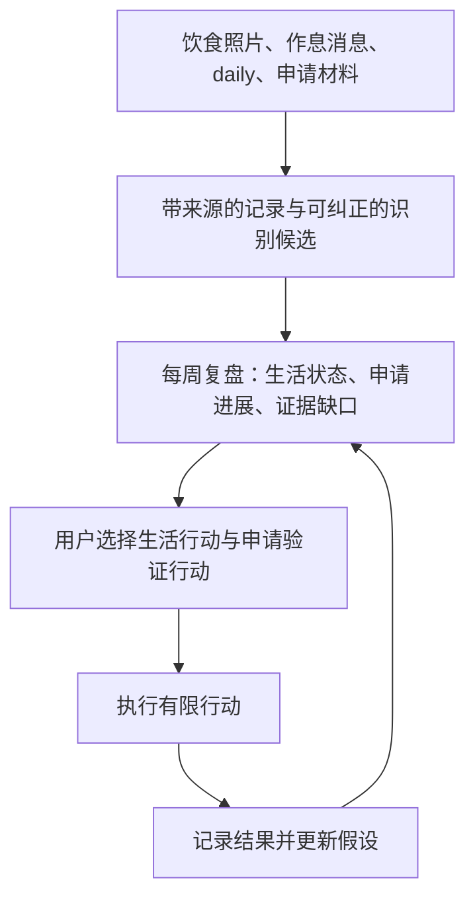

# 个人助手迭代：研究生申请与生活反馈

更新日期：2026-10-13。本文定义产品需求与验收场景；仓库中尚无助手实现，不表示飞书、journal 读取或模型调用已经启用。

## 1. 本轮确认的需求

| 项目 | 当前需求 |
|---|---|
| 升学阶段 | 大三，专业为微电子科学与工程 |
| 研究方向 | 计算机系统设计、软硬件协同设计、高性能计算 |
| 地区偏好 | 中国内地优先，香港其次 |
| 升学路径 | 推免为主 |
| 时间目标 | 2026 年开始套磁，目标 2027 年 9 月拿到 offer |
| 饮食目标 | 健康饮食，同时希望减脂 |
| 作息问题 | 熬夜，希望通过睡前与起床消息记录 |
| 日常入口 | 飞书聊天；饮食按上传照片设计 |
| 心理状态依据 | 允许全量只读访问电脑上 Obsidian 的 `daily` |

“今年开始陶瓷”按“今年开始套磁”理解。2027 年 9 月是用户目标；各项目、夏令营、预推免、推免及香港申请的实际窗口必须从当轮官方资料核实，不能直接套用这一日期。具体学校、成绩排名、推免资格、科研经历、语言成绩、预算与 Obsidian 根路径仍待补充。

本次迭代从访谈摘要提取四个产品原则：低成本接入、扩大信息后再选择、用实际行动验证假设、根据反馈更新判断。访谈列出的六类机会和“研究 100 个对象”是探索灵感，不是必须追逐的行业清单或固定数量门槛，也不作为当前市场事实。

## 2. 一条连接生活与发展的闭环

健康和生活状态本身就是目标。助手也用用户确认的时间与精力约束安排申请准备，但不会因一次晚睡或某篇低落的 journal 判定用户“不适合科研”。研究生申请是职业路径的一次选择，比较时需讨论毕业后希望做什么，而非只比较学校排名。

不等积累两到四个月才开始服务。先利用已有 daily 和申请材料，首周即可列出事实与缺口；生活记录逐步建立个人基线。更长时间的数据用于复核趋势，不是启动前提。

## 3. 飞书中的低负担记录

### 饮食照片

1. 用户上传一张餐食照片，可选补充“午饭”“还有一杯饮料”等短说明。
2. 助手创建 Meal Capture，区分上传时间与实际用餐时间；补发照片不自动算成当前的一餐。
3. 视觉模型返回可见食物候选、无法判断的部分及不确定性。酱料、烹调油、遮挡食材、份量和照片外食物不能凭空补齐；照片不直接给出精确热量或营养摄入量。
4. 飞书返回简短候选，例如“可能是米饭、鸡肉和青菜；份量与油盐未知。认错的部分可以直接纠正”。明确的用户修订单独保存，覆盖候选解释但保留修订历史；没有纠正不等于确认识别正确。
5. 日常默认无需填写完整表格。只有关键歧义才追问；不回答时保留未知，不阻塞其他记录。

饮食复盘关注已记录餐食中的搭配与规律，先展示记录覆盖度，再讨论可调整的选择。“照片里没看到蔬菜”不能写成“今天没有吃蔬菜”。减脂效果也不能只从食物照片推断。

体重或围度作为用户自愿提供的补充，不是使用条件；若提供，保留单位、时间及测量条件，不用单次变化判定效果。具体体重目标尚未确定。需要个体化摄入量或医学营养建议时，另行收集必要条件并核查专业依据；本轮不设每日热量、减重速度或限制性食谱。

### 睡前和起床消息

- “睡觉了”：记录准备睡觉事件；“起床了”：记录起床事件。时区默认 Asia/Shanghai，旅行时可修改。
- “昨晚一点睡的”或“刚才发错了”：支持补记和更正，分开保存事件时间、消息时间与修订信息；表达歧义时澄清。
- 跨午夜按事件时间配对，不按消息所在自然日强行分组。重复投递同一条消息不能生成两份记录。
- 只有一端时显示未配对；不能用缺失事件、手机沉默或 journal 时间戳补出入睡时间。
- 完整配对得到的是自报作息区间，不是实际睡眠时长。午睡、夜间起床和分段睡眠单独标记，不能全部并入一个“夜间睡眠”。

首版展示用户自己的时间分布和变化，不预设“正常作息”分数。睡眠质量和次日精力可以选填；没有记录就保持未知。

### 本机离线或识别失败

飞书必须区分“收到输入”“已写入本机来源”“已完成识别”。本机离线时显示等待节点，恢复后续处理；同一照片或消息的重试按原事件身份去重。照片相同但用户明确表示是另一餐时允许另建记录，不能仅凭图像哈希吞掉真实新事件。

云模型失败时先保留已成功存入本机的照片，标记待识别，允许一句话手工补充。队列到期、附件无法获取或写入失败应明确通知，不显示“已记录”掩盖丢失。已有成功结果时重试不得再次调用模型、重复写入或重复发送同一回执。远端请求超时且结果未知时先标记待核查，不盲目重新调用；重试能力与可能的再次计费按提供商实际支持情况和预算处理。

## 4. Obsidian daily 与心理状态复盘

用户已允许全量本机只读访问 `daily`。配置实际根路径后，可建立历史索引并持续核对新增、修改和删除；不改写 journal，不把历史全文迁入 VPS，也不将全量内容塞入提示词。

复盘默认从本周及相关近期记录开始，必要时检索较早的相似情境，并标明对应日期和原文位置。分别展示用户自述、模型暂定解释和仍不清楚的内容；不要将日记中的引用、对他人的描述或假设情境归为用户自己的状态。

心理状态回顾的用途是帮助用户理解近期困扰、发现值得讨论的重复主题，并调整自己的计划。一次抱怨不是永久特征，多篇相似表达也不是心理诊断。用户可以纠正、排除某段内容或要求不再使用某个推断。

全量本机读取不等于云端处理授权，也不改变 `Daily/` 原有的“不可用于个人模型”政策。首版可做本机证据检索和用户自行复盘；需要模型解读时，采用满足来源政策的本地模型，或先在本机明确限定云端可用片段、提供商与用途。没有可用处理路径时应显示这一限制，不能静默上传或声称已经完成心理分析。

## 5. 面向推免的申请与职业选择

### 先整理可验证的个人基础

用户补充成绩、排名与统计口径、推免资格状态、课程、项目或科研材料、语言能力、申请投入上限和对未来工作的偏好。已证明能力、用户自述兴趣、助手推测分别记录；未知项保持待补充，不编造竞争力或录取概率。

三个研究方向先作为 Direction Hypotheses。每个方向需连接已有微电子背景与真实项目证据，列出需要补足的能力及可以低成本验证的下一步。方向可能重叠，不按名称互斥分类，也不因某模型看好就宣告选定。

### 申请候选比较

每个 Graduate Application Option 以具体项目、导师或课题组及申请轮次为单位，记录：

| 比较内容 | 所需依据 |
|---|---|
| 方向与课题匹配 | 项目介绍、近期论文、课题组公开成果，与个人材料的连接 |
| 申请资格与窗口 | 当轮官方要求、推免资格、材料、语言要求、截止时间及时区 |
| 培养与职业连接 | 学位类型、培养安排、研究机会、公开可核查的毕业去向 |
| 资源与成本 | 官方学费、奖助信息及用户预算；缺失项不估作零 |
| 实际可行性 | 已具备的证明、待补能力、准备时间与其他申请冲突 |
| 风险与未知 | 招生信息未更新、导师名额未确认、过期或相互矛盾的资料 |

排名只是一项可选信息，导师或团队风格不能由论坛传闻直接定性。香港项目作为用户明确的第二优先地区保留，不能把“其次”解释成无需研究或无需提前准备。

每次 Decision Brief 提供两到三个可行路线及取舍，列出需要补证的地方、改变判断的条件和一个验证动作。可以给有依据的倾向性建议，但不输出保证录取、保证收入或唯一正确路线。

### 时间线与行动

- **2026 年启动套磁**：整理材料与研究兴趣；核实目标团队当下是否适合联系，再准备个性化邮件草稿与沟通问题。
- **2027 年申请准备与申报**：按各项目当轮公开窗口倒排材料、研究准备和面试；夏令营、预推免、推免与香港申请分别记录，不编造统一时间表。
- **2027 年 9 月目标复核**：跟踪 offer、条件与回复期限；这是用户目标，不保证所有地区或项目会在此时出结果。

本轮只设计套磁支持，不发送邮件或联系导师。邮件发送遵循 PA5 的精确确认与防重机制；PA5 之前可以提供草稿由用户自行发送。候选截止时间要经核实与用户确认，PA3 才能投射至日历。

Action Trial 可围绕阅读一篇目标团队论文并写出问题、复现一个小实验或梳理已有项目展开。每次只选一个申请验证行动，明确时间与投入上限、产物、继续或停止条件。结果用于更新方向假设，不能以一次失败给用户贴“不适合”的标签。

## 6. 每周生活与申请复盘

建议默认每周一次、约 10–15 分钟，具体时段由用户选择；这是设计起点，不是已经启用的定时任务。日常主要依靠照片、两条作息消息与已有 daily，不额外强制填写情绪表。

复盘按以下顺序呈现：

1. **事实与覆盖度**：哪些餐食、作息事件、daily 和申请材料实际可用，哪些缺失；不同字段分别报告记录数量及有效时间窗口。
2. **本周变化**：与自身过去窗口比较，附证据与不确定性；来源或记录方式变化时提示可比性下降。
3. **可能的联系**：例如晚睡与“第二天难以学习”的自述是否同时出现。只能提出待验证解释，不能写成因果或诊断。
4. **申请进度与障碍**：新证据、候选变化、材料缺口、临近且已核实的窗口。
5. **用户选定下一步**：一个生活改善行动和一个申请验证行动；允许维持、减少或暂停行动，并约定如何复盘。

未确认的分析不自动升级为个人模型、Task 或 Reusable Rule。每周回顾强调用户目标与可用精力，不用一个综合分数评价健康、情绪或人生表现。

## 7. 多模型与机会信息

普通餐食识别和日常复盘不默认并行调用多个模型。多模型主要用于重要申请方向分歧或投入较大的决定：先用两个模型独立分析同一份政策允许的证据快照，再对比假设、证据缺口与验证建议。有明确未解分歧且预算允许才增加复核。

模型共识不是外部证据。允许不同模型使用的资料范围可能不同；范围不同就说明可比性限制。费用合并计入本次复核预算，提供商失败或预算耗尽时保留部分结果，不追加未授权模型。免费产品可作为手工复核入口，不能假定有免费 API。

技术机会追踪先围绕三个已选研究方向，拓展到相关项目、课题组或实践机会；海外、科研或商业方向作为待验证线索，不直接生成投资或创业行动。扩大信息覆盖到足以比较资格、方向、成本与时间约束，再深入少量候选；不把“看够 100 个”作为申请决策门槛。

后台追踪必须另建 Opportunity Subscription，约定主题、来源、频率、费用上限、到期日与暂停方式。建议先试每周少量高相关线索，未启用订阅前仍为按需研究。自动抓取的论文、公告和机会都要保留日期与出处；媒体讨论只用来发现待核查线索。

## 8. 数据、权限与成本

| 数据或行为 | 默认边界 |
|---|---|
| 飞书上传的餐食与作息 | 用户选择的采集渠道；飞书平台会接触并可能保存原始提交内容 |
| 飞书即时回复 | 可回显本次输入的识别候选、修订与记录时间；不带入 daily 原文或心理分析 |
| Obsidian daily | 全量本机只读；默认不进云模型、不进 VPS、不生成永久心理画像 |
| 照片视觉处理 | 本机配置选定支持视觉的提供商及最小图片范围；不开通时保留照片并支持手工说明 |
| 每周完整健康与心理复盘 | 本机或满足私密展示政策的控制台；不默认发送至飞书 |
| 申请材料与多模型复核 | 按来源与提供商逐项控制；只发送当前问题所需的片段 |
| 代码与模板 | 可进 Git；真实照片、daily、健康记录、识别结果和操作记录不进 Git |

飞书采集需要在启用时展示一次明确的数据路径与授权范围。已授权范围内的重复记录不逐餐索取许可；更换提供商或扩大用途时重新审查。飞书采集许可不扩展为“可以给所有模型发送全部健康和心理资料”。

VPS 仅作协调：飞书事件处理可能短暂接触明文，但不持久化明文照片、作息内容或其日志；待本机接收的输入按节点加密，并设置有限队列保留期。飞书平台自身的存储不是本机加密能消除的。队列到期需显示未完成与重新提交方式。

敏感来源默认不向协调目录暴露标题与路径。实际 journal 根路径、记录落盘位置、图片保留期限、队列期限、视觉提供商、模型费用上限与备份位置在部署时确定。个人原始记录的保留期与照片删除机制需单独设置，不能直接套用普通操作日志的 180 天。

模型费用分为餐食视觉、按需申请研究及可选复核，分别限额并合计查看。限额到达后暂停新的模型调用，仍保留允许的记录、检索和手工修订能力。不要求先购买穿戴设备、NAS 或更多订阅。

## 9. 实施顺序与第一条完整流程

PA0–PA5 的基础设施顺序保持不变。新增场景作为领域试点推进，不要求等邮箱、日历或记忆全部完成才使用。

| 交付切片 | 首要结果 | 依赖与边界 |
|---|---|---|
| 需求与来源准备 | 确认 journal 路径、申请材料、采集落盘源与来源政策 | 当前文档阶段；不修改原文、不启用实时采集 |
| PA0 证据底座 | 申请材料与获准 daily 的本机检索，可回到原文 | daily 搜索结果不默认发飞书/VPS；PA0 仍不做图像理解 |
| 作息采集试点 | 飞书事件可靠落盘，支持补记、跨日与离线 | 明确的采集权限、节点加密队列、幂等回执；无需 LLM |
| 饮食识别试点 | 照片记录、视觉候选、用户修订 | 单独验证视觉模型能力与图片政策；不扩为全库多模态索引 |
| PA1 申请探索与周复盘 | 方向候选比较、已授权数据的生活复盘 | 申请信息查一手资料；journal 的模型处理需合规路径 |
| PA2–PA4 反馈接入 | 选定行动成为任务，按需进日历，复核纠正后沉淀规则 | 沿用确认、审计与记忆边界 |
| 后续增强 | 多模型复核、订阅追踪、PA5 套磁邮件、可选设备接入 | 分别验证成本、数据权限和外部写操作 |

第一条可反复使用的流程是：**飞书上传餐食和作息 → 本机形成可纠正记录 → 结合近期 daily 与申请材料做一次周复盘 → 用户选择一个生活行动与一个申请行动 → 下周检查结果**。若 journal 只允许本机读取而当前只有云模型，流程明确退化为本机证据展示和用户复盘，不伪装成自动心理分析。

## 10. 场景验收

只用合成数据验证流程，不将真实 daily 或饮食照片加入测试仓库。

1. **照片不确定性**：遮挡、缺少份量或餐外食物时保留未知；用户纠正后只更新对应候选，未回复不算确认，缺少照片不算没吃饭。
2. **作息时间**：跨午夜、补记、时区更改、只有起床事件与午睡均正确保留；输出叫自报作息区间，不叫实际睡眠时长。
3. **重复与离线**：同一飞书事件重放仅写入一次；节点离线显示等待；恢复后完成或到期明确失败，不能产生假成功或重复回执。
4. **journal 授权**：可全量本机读取并跟随修改、删除更新检索；引用定位正确；未授权云处理时，模型请求、VPS、飞书与日志均不出现原文或心理解读。
5. **申请事实**：针对三个方向提供两到三个路线及证据缺口；官方信息未发布、过期或缺失时标为待核实，不生成录取概率或虚构截止日期。
6. **计划与外部操作**：2027 年 9 月仅作目标；未确认候选不变成任务，套磁草稿不自动发送，日历不在确认前写入。
7. **复盘可靠性**：稀疏记录显示覆盖度，引用 journal 的他人描述不误归用户，相关变化不写成因果，用户纠正不自动变成永久心理标签。
8. **隐私与费用**：识别和复核只发允许的最小上下文；视觉不可用或费用到顶时仍可记录与修订；私密来源不泄露标题、路径或原文到非授权渠道。
