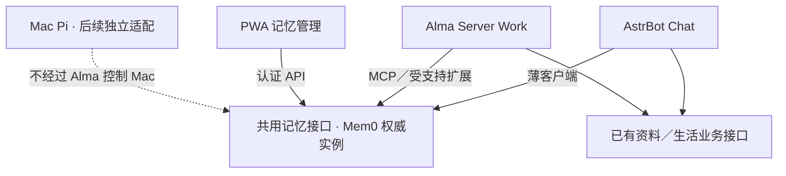

# 共用能力、记忆与模型配置

更新：2026-11-10。本文件维护选型／契约及M1验收：独立合成权威接口、语义／并发／撤回／鉴权、真实SDK断点与恢复已通过；常驻资源门槛未签收，M1尚未完整通过。合成服务已停用，未导入个人内容或接Chat／Work。用户已取消Magpie，Chat Router与Work原生模型配置分别维护。详见[初始化清单](2026-11-10-mem0-initialization.md)、[运行说明](../shared-memory.md)和[验收](../validation/mem0-m1-20261110.json)。

## 1. 按当前架构做选择

2026-11-10后续取舍：当前不继续推动Mem0上线，也不为本试点单独扩容；优先共用资料和Chat／Work质量。保留统一有效偏好／决定来源的目标与现有Mem0试点，自动共享个人记忆明确暂缓，共用资料查询不视为它的完整替代。后续按实际痛点和容量重新决定恢复时机，见[依据](../shared-memory.md#当前取舍2026-11-10)。下述候选比较仍保留原日期和研究边界。

实际约束如下，优先级高于外部推荐排名和厂商 benchmark：

- AstrBot Chat和Alma Server Work均已独立部署，Mac Pi保持本地使用。记忆层尚未接入，必须独立于三者的Agent循环。
- VPS约0.94GiB RAM，已有swap与Work资源上限；原始研究时约437MiB可用内存是旧快照，不能用于证明当前常驻余量。不能未经测量再叠加记忆服务、PostgreSQL、图数据库或本地模型。
- 首期共享内容是稳定偏好与明确决定，要求来源、纠正、撤回、跨会话检索；暂不需要对全人生资料形成关系图或后台生成个人信念。
- 已有 Python 业务模块、SQLite 资料副本、独立同步和认证 PWA。可复用这些入口，但不应再维护自研记忆抽取／检索核心。
- 资料留在既有节点与授权范围；没有自动授权上传到任何记忆 SaaS，或启用默认 OpenAI／其他新提供商。

### 1.1 四个候选的实际取舍

| 候选 | 本次核实的能力与约束 | 对当前架构的结论 |
|---|---|---|
| Mem0 OSS | 独立记忆 SDK；可用本地 Qdrant 与 SQLite 历史；提供 metadata、更新／删除／历史；仍需配置 embedding，默认抽取还使用 LLM | **首个试点**。能作为小型独立服务，不替换两端 Runtime；首期不用完整服务器套件和 Graph |
| Hindsight | Retain／Recall／Reflect、时间检索与观察整合，有现成 MCP；当前要求 PostgreSQL 与向量扩展，即使 slim 包也保留数据库／工作流依赖 | **最强的后备候选**。若以后主要瓶颈变成认知演变、跨时间关联与反思，值得重评；目前增加的运行面超过首期需求 |
| Letta | 当前源码迁至 letta-code；MemFS、身份、会话、工具和 App Server 属于整套 stateful harness | **不选作当前共享层**。只为共享偏好引入另一套 Agent 身份与运行时，会破坏本轮解耦目标；未来真要替换核心再评估 |
| Graphiti | 时间有效关系、出处、图与语义检索；支持 Neo4j／FalkorDB 等，也有嵌入式选项 | **当前不选**。嵌入式选项并不消除图建模与抽取成本；AI Trajectory 首先需要可见事件与成果链，不必先建关系图 |

依据：[Mem0 OSS](https://docs.mem0.ai/open-source/overview)、[Hindsight 安装](https://hindsight.vectorize.io/developer/installation)、[Letta 当前入口](https://github.com/letta-ai/letta)、[Letta MemFS](https://docs.letta.com/configuration/memory)、[Graphiti](https://github.com/getzep/graphiti)。

### 1.2 为什么最终仍选 Mem0 试点

选择依据是“可以独立嵌入、首期依赖可收敛、无需接管 Runtime”，不是“GPT 把它排第一”。核对的 Mem0 基础依赖包含 qdrant-client、Pydantic、OpenAI client、httpx、SQLAlchemy 等；本地 NLP／Transformer 属于可选依赖。Hindsight 即便使用 slim，也需要 PostgreSQL、向量扩展及更完整的 API／后台处理栈。该差异是依赖结构比较，**不是已测得的内存或质量优势**。

Mem0 也有明显代价：metadata 不会自动保证事实正确；`infer=True` 的默认抽取会决定新增／更新／删除，仍可能错误归因；SDK 不替项目处理鉴权、跨端撤回、并发修订与原始出处。其托管平台 benchmark 不能直接套到 OSS。我们维护的是窄适配与业务规则，不重造向量库、召回或记忆算法。

如果它在中文偏好修订、来源保留或撤回试验中不过关，停止推广并用同一验收集评估 Hindsight；不同时启动四套候选，也不把“能安装”当作选型通过。

### 1.3 具体试点形态

- 单个独立进程持有固定版本的 Mem0 OSS SDK、持久 Qdrant local 数据和其历史库；由 Chat／Work 的薄客户端访问。
- 不把 SDK 安装进 AstrBot 的现有依赖环境；不让 AstrBot 和 Alma 各自打开同一个 Qdrant local 目录。使用一个权威服务实例，避免文件锁与并发一致性问题。
- 不采用默认 `/tmp/qdrant`，为向量与历史显式设置私密持久目录。当前 `/tmp` 仅约 482 MiB，不适合作为安装或数据目录。
- 不启用 Graph、本地大模型、本地 reranker、NLP extras；首批只接少量合成偏好／决定。不建立第二套自研记忆核心。
- 显式配置已获准且能工作的抽取和 embedding 提供商。若没有现成获准的 embedding，实施阶段先解决该依赖；不因默认配置悄悄新增账号或云端资料流。
- SDK 与完整自托管 Server 的默认栈不同：当前完整 Server 默认 PostgreSQL／pgvector。不要把 SDK 轻量部署与完整 Docker 套件混称同一个资源方案。
- 检查并关闭不必要的遥测／正文日志；不要将源消息或上游错误正文写入运行日志。

来源：[默认组件](https://docs.mem0.ai/open-source/overview)、[基础依赖](https://github.com/mem0ai/mem0/blob/main/pyproject.toml)、[Qdrant 适配](https://github.com/mem0ai/mem0/blob/main/mem0/vector_stores/qdrant.py)。

## 2. 一个权威记忆，多端独立会话

该图为目标，不表示已建服务。Chat／Work 不导入对方运行模块，不共享活动会话数据库。共用服务不可用时，各自仍能使用自身会话；依赖记忆的问题需明确资料暂不可用，不编造记忆或假称使用了最新版本。

### 2.1 身份、输入与来源

- 可信客户端把本人绑定为稳定的内部 user_id；不能让模型选择别人的身份。
- 个人共享记忆以相同 user scope 查询。agent／session 作为出处 metadata；不要把不同 agent_id 或 run_id 无条件放进个人查询过滤器，意外隔离成三套个人记忆。
- 首期自动沉淀只面向本人明确表达的稳定偏好、明确决定。日常聊天原文仍在原会话；自报生活／学习事实留在已有证据体系，不把普通聊天全部提升为行为记录或 Journal。
- AI 建议、引用、资料内文字、任务指令、临时要求和推测不能伪装为本人稳定事实。只传必要的本人原话及有界消歧材料，不把整段助手回复喂成个人画像。
- 保存来源消息身份、来源端、表达者、内容类型、适用范围、有效时间和修订关系。模型输出的概括必须能回到原话。

### 2.2 自动保存与更新

推荐首期采用“业务规则筛选＋有来源的候选抽取＋Mem0 存储／召回／修订”。优先验证 `infer=False` 写入已筛选记忆，再按明确目标调用更新；这样可避免第二次泛化抽取扩大事实范围。`infer=False` **仍会生成 embedding**，不能说零模型成本。若使用 `infer=True`，必须通过相同的身份、修改与撤回用例，不能直接照抄全对话 add 的示例。

Mem0 已提供更新、删除和 history，予以复用。薄适配仅补充入口鉴权、来源去重、修订串行化／预期版本核对及撤回传播；这不是另造一套记忆引擎。只按明确语义修订：同范围偏好可被后续明确表达替代，“这次简短”不修改全局偏好，计划取消不变成已完成。

当前 SDK 需按所选版本调用：核对时 `add` 接收顶层 user_id，而 `search`／`get_all` 使用 `filters`。不从托管 Platform 示例推断 OSS 支持所有参数。[SDK 源码](https://github.com/mem0ai/mem0/blob/main/mem0/memory/main.py)

### 2.3 撤回和唯一权威

- 查看、纠正、撤回都作用于权威实例；同时让客户端缓存失效。历史记录与原聊天的保留范围分别说明。
- 用户明确要求忘记的来源不再被后台历史重扫重新提取；复用小型撤回／来源收据，不在 receipts 再保存一份权威记忆正文。
- Alma 原生重叠的个人自动记忆关闭，或严格限定为非权威的 Work 局部资料；不得一边读取 Mem0、一边把不同画像无条件注入同一回答。
- 既有批准背景／初始化背景保留为带日期的历史来源，不自动重写其私密文件；当前稳定偏好与决定以 Mem0 有效版本为准，避免旧 profile 和摘要被重复注入后反向覆盖新纠正。历史背景发布与 Journal 写入仍遵守原有确认。
- Mac Pi 后续经独立客户端或既有受控同步取得记忆；Alma 不因此获得 Mac 连接。离线副本显示版本与取得时间，旧版本不能覆盖新纠正。

### 2.4 M 阶段与退出条件

| 阶段 | 工作 | 通过条件 | 当前状态 |
|---|---|---|---|
| M0 | 固定版本／提供商／存储与接口，建立合成案例集 | 成本和资料流明确；未依赖默认新账号；身份和语义用例完整 | 固定SDK／提供商／存储与窄接口，14类语义／事务契约已实现 |
| M1 | 独立 Mem0 SDK 试点，不导入真历史 | 新增／检索／更新／删除／history、重启持久化、并发修订均可核对；记录实际资源和真实调用 | 功能／鉴权／并发／撤回／断点恢复通过；资源门槛未签收，服务已停用，M1不标完整通过 |
| M2 | 起始内容初始化、Chat 适配与 PWA 管理 | 已批准背景逐条核对后幂等导入；新会话可回忆稳定偏好；一次性要求不全局化；纠正与撤回立即影响 Chat；Work 无须在线 | 待M1通过后按初始化清单实施，未导入个人内容 |
| M3 | Work 适配 | 同一 user scope 得到相同当前版本；移除 Work 适配不影响 Chat；Alma 重叠记忆不成为第二权威 | 未接入 |
| M4 | 可选 Mac 适配、导出与恢复 | Mac 无 Alma 控制连接；停服务、导出、恢复后撤回与版本仍保持；旧副本不复活已忘记内容 | 未实施 |

首期用例必须包括：稳定偏好新增、明确决定、临时要求、否定、引用、AI 建议、计划取消、明确纠正、同名不同项目、并发纠正、重复来源、删除后重读旧聊天、服务中断。未通过就不扩大自动沉淀范围。

### 2.5 初始化是首次可用的必要环节

按[Mem0 初始化与首次可用验收](2026-11-10-mem0-initialization.md)的I0–I7执行：核对现状→持久权威服务→M1合成／真实模型验收→起始背景候选→幂等导入与读回→Chat→Work。备份／恢复是首次上线前置，不推迟到可选Mac适配。

内容初始化优先复用VPS当前仍获准且有效的背景来源，只将有本人依据的稳定偏好与明确决定迁为有效记忆；过时、冲突、撤回和身份不清的内容不自动导入。新生成／修改背景继续遵守原有具体预览确认规则；启用后明确的新偏好／决定按既定契约自动保存，不逐条重复审批。没有可用候选可以从空库开始，但须如实说明历史背景未迁入，不将空服务标为已有个人记忆。

## 3. 保留现有 Router，不新增模型网关

用户使用的模型数量有限，已决定不再评估或接入 Magpie。当前计划不增加共享网关，不保留网关替换试点作为后续默认任务。Chat 改进现有 Router，Work 使用 Alma 原生提供商配置，两端独立维护。

| 职责 | 目标归属 |
|---|---|
| Chat 模型选型、现有额度桶、冷却、错误区分与路由记录 | 现有 Smart LLM Router |
| Work 模型配置、手动选择及运行回执 | Alma 原生提供商与运行时 |
| 用户显式单轮选型、当前会话／用户轮身份、工具循环 | AstrBot／Alma 各自的运行时与窄适配 |
| 原始历史保留、工作上下文预算和压缩、后台任务隔离 | Chat 自己维护一条受控路径；Work 由 Alma 自己维护 |
| 跨会话稳定个人信息 | Mem0 权威实例 |
| 模型 Emoji／实际后端显示 | 读取各自真实调用回执，不依赖模型自己报名字 |

### 3.1 现有 Router 的改进门槛

保留今早的上下文与明确选型修复，仅对实际痛点做有界改进。验收覆盖：

- 当前已配置的 Google／MiMo／DeepSeek；Gemini 思考参数、工具 schema、流式／多模态，以及已隔离的不可用模型不被目录发现自动重新启用。
- 显式指定模型不可用时明确失败，不用其他模型或风格模仿冒充切换。
- 429、每日额度桶和时区重置、明确 503，与请求发出后的 504／超时／断线／取消严格区分。
- 已完成工具在换模型、参数修复及后续回答中只执行一次，当前工具链完整保留。
- 选型忽略时间附加块与引用，只看真实本轮意图；摘要请求不递归触发摘要。
- 比较改动前后的选型、首字延迟、总延迟、工具成功率与成本；不默认新增分类模型调用。
- 实际模型、规则命中和降级原因可核对；PWA 与飞书展示不把本地观测额度当成官方余额。

### 3.2 两端独立维护

- Chat profile 与 Work 模型配置分别修改、验收和回退，任一端改默认模型不改变另一端。
- 不自动扫描或导入 Mac Keychain／订阅账号，仅使用明确批准的提供商和资料范围。
- Chat 保留当前 Router 版本回退，Work 保留自身原生配置回退；两端都不自动重放未知请求。
- 共用工具与记忆不要求共用模型网关，也不要求两端同时改模型通路。

## 4. 资料工具与只读状态契约

共用业务接口按能力拆分：资料搜索／日期枚举／分页读取、五彩读取、生活记录查询、记忆、日历提案、Journal 草稿。内部复用现有模块，客户端不直接互拷活 SQLite 或接收任意路径／SQL。身份从可信连接绑定，每次调用重新校验。

资料结果包含来源、版本、取得时间、覆盖与继续游标。相同来源在两端应能核对；全文未读完不能包装成完整总结。非工作记录不能因 Work 工具可写就提升为生活事实。

PWA 统一显示 Overview／Dashboard，但不成为第三个 Agent。Work 只读状态建议提供：服务版本、状态、观测时间、能力就绪情况和有界任务计数；任何字段未取得就显示未知。Work 可未安装／停用，PWA 不同步导入 Alma 数据库或执行器，不自动派发工作。

现有 Router／记忆服务只读暴露必要健康与统计；写入操作只走认证、来源绑定和本次操作确认的独立入口。Alma 默认本地 API 具备高权限，不能把它直接公开代理成 PWA 接口。

## 5. 原始只读调研快照与研究版本

以下保留计划制定时的证据，不描述当前部署。催睡、后台隔离和Overview现状见[Chat实施回执](2026-11-09-chat.md#7-c0c1-实施回执)，Alma现状见[Work实施记录](2026-11-09-work.md#6-2026-11-09-实施与证据)。

- 本地代码检查点 `ecf6a39`。VPS Router 发布 `20261109_110914_148969`，四个核心在线模块与清单一致，原生摘要 Provider 为空、轮次截断关闭。它是已实施的今早修复，不是下一轮新功能。
- 本轮近期普通对话仍有两次无 `/life` 的 `life_organize` 尝试，均被 `explicit_life_entry_required` 拒绝；是工具选择质量问题，不能写成生活库已被污染。
- 最近会话有两个 Scheduler 合成 user／Cron 报告对，说明当前普通上下文仍含后台任务写回。
- 调研时催睡policy的enabled为true，当时没有关闭；后续C1已删除有效执行与启用路径，旧policy幂等停用。
- 调研时PWA已有生活／习惯／学习／纠正等详情，尚无独立Overview；未认证回环得到403，当时没有已登录UI验收。后续C7基础Overview已上线，真实登录使用仍单列验收。
- 调研时仅校验Alma Server 0.4.530归档并静态查看README／bundle，尚未安装或配对；后续W0–W1已部署并通过手机文件任务，长期资源仍未完整验收。

研究 HEAD 仅用于定位证据，coding 前须固定所选版本后重新检查 API：Mem0 `f1791daa86d469249c9b002f62644d58a1eb96a0`；Hindsight `0bd55015393d224deec1073d63b24bcc0faad164`；Graphiti `024b83679e48e41d59a7d1714ac0870aff2e4676`；Letta Code `7f7300a2c8d4d8aef150d9ea9d01f0edd4f9d710`。公开 main 会变化，这些不是已安装版本或性能验收。

## 6. M0／M1 部分实测回执

本节保留11月9日原试点。11月10日后续已完成真实MiMo语义、鉴权、并发、来源去重、撤回history清理、SDK提交后收据中断恢复和旧备份恢复；资源观察发现压力，因此停止并禁用合成服务。M1当前缺口收敛为常驻资源验收，不自动重跑已通过的付费用例；原试点账本／数据保留。见[后续回执](../validation/mem0-m1-20261110.json)。

2026-11-09已在VPS独立虚拟环境安装`mem0ai==2.2.1`及`google-genai==2.18.1`，不改AstrBot环境。与本计划固定研究版本的[依赖声明](https://github.com/mem0ai/mem0/blob/f1791daa86d469249c9b002f62644d58a1eb96a0/pyproject.toml)及[Gemini适配](https://github.com/mem0ai/mem0/blob/f1791daa86d469249c9b002f62644d58a1eb96a0/mem0/embeddings/gemini.py)对应。现有VPS Google账号的gemini-embedding-001／768维真实可用，单次请求关闭自动重试；没有新增云端账号或转移凭据。

使用`infer=False`和纯合成偏好实测新增、检索、更新、来源metadata、身份隔离、history、进程重启和删除；持久本地Qdrant与SQLite历史，遥测关闭，不启用Graph／本地模型／reranker。先做1次向量探测，再做4次SDK向量调用；没有抽取模型生成或真人历史导入。独立进程峰值137.8MiB，核验进程117.76MiB；试验限制192MiB内存／128MiB swap／40%CPU，结束后没有常驻服务。这只是本次合成负载观测，不证明在当前约1GiB机器上常驻资源已通过。

M1尚未完整通过：14项语义接受契约、并发修订预期版本、来源去重与撤回不复活、鉴权权威接口／客户端失联和常驻资源余量仍需完成。SDK CRUD不替代这些门槛，不能启用Chat自动抽取或接入两端真资料。版本清单、实际调用与未通过范围见[试点验证](../validation/mem0-pilot-20261109.json)。

## 7. Work交付后的接入边界

2026-11-10：本人选择先W2再M1；W2共用资料只读接口已独立部署，以Unix peer UID绑定Work，经原生MCP复用只读副本及现有五彩能力，无数据库／凭据复制或新资料来源。实际SDK／资料／真实模型／离线隔离通过，手机自然任务待验收。M1权威记忆及W3仍未实施，历史试点结论不变；见[W2说明](../work-knowledge.md)。

Alma 0.4.530已完成独立部署、配对及本人文件任务；MiMo与DeepSeek均已配置，默认MiMo，工具选择模型复用MiMo。两者Alma模型容量修正为1,000,000 token，输出4096及80%原生压缩策略保留；真实超过旧32K的连续回查通过，不代表全1M满载或并发验收。此容量不等于Chat Router的32K／64K出站预算，也不引入共用模型网关。[上下文证据](../validation/alma-context-20261109.json)。

Alma原生记忆主要开关和主动Check in关闭，未导入真人历史、未接Mem0；W2只读共享资料已接入，不能把资料访问、不同Chat或共用Project的文件关系冒称共享长期记忆。下一步先完成M1剩余资源验收及初始化，再由Chat／Work各自接入；W5只读PWA适配仍待实施，既有来源权限和确认规则保持。
