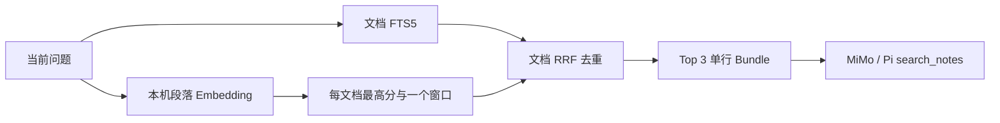
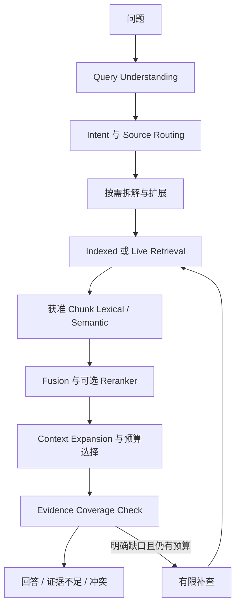
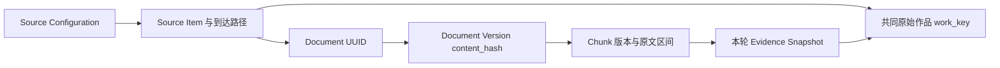

# Retrieval V2：审计、基础实现与质量门槛

2026-10-18 初次完成 Phase 0 合成基线与 Phase 1 独立本机闭环；随后按用户明确要求发布 `retrieval-v2-de593bc25486b7cc` 到 Mac／VPS，并增加显式飞书只读实验。**普通生产 PA1、Pi 工具与旧付费协议没有切换**，Phase 2 仍仅设计。来源与模型／渠道政策未改，无生成调用或后台抓取。初次未部署的验收保留在原记录；续发见[部署验收](validation/retrieval-v2-deployment-20261018.json)。

## 当前代码与运行审计

本机 `main` HEAD 与 GitHub main 均为 `b5d2d25d7b2db8eb9617cdd3a01070a5396971b5`。开始时已有外部阅读接入的修改和未跟踪文件；它们已超出 main 的旧文档状态，本轮保留。基线使用**开始时的工作区实现**，包含该接入，不能等同于纯 Git main。基线 JSON 保存参与检索文件 SHA256。

初次部署前只读检查 launchd：Mac、PA1、隧道、独立小红书服务均 running；隧道有历史退出码 255，但当前 running，不能推断当前断开。PA0／PA1 PYTHONPATH 指向仓库外发布。只读统计生产索引：Study 267、Life 184、WUCAI 24、Folo 9、小红书 8（共 492 个活动条目）；活动数不等于实时可用、全文数或授权披露数。初次验收没有用真实私人正文跑质量评测，也没有建立生产 V2 sidecar；续发协议验证按既有权限读取相关候选，sidecar在Mac本机生成，正文与标题未写入公开记录。

旧调用路径：`cli pa1 retrieve → retrieval.retrieve → Index.search + semantic.semantic_scores`；`pa1.analyze → build_bundle → ContextBundle → MiMo`；`agent.AgentHost.tool(search_notes) → build_bundle`。专业角色使用首次工具证据，`role_context` 只增加匹配目标／历史，`work_history` 复核旧证据，不是新的原文检索。

| 问题 | 当前依据与影响 | 推荐修改与阶段 |
|---|---|---|
| 1. 无空格中文 | `index.Index.search` 按 `\S+` 拆词、长词用 AND 短语；PA0 高影响。PA1 无 encoder 时已有 `retrieval.features` 汉字二元 TF-IDF 补召回，并非完全不能搜中文 | P1 V2 将二元词预分词后放入 Chunk FTS5，OR 召回＋BM25；PA0 不改 |
| 2. 按文档取语义最大值 | `semantic.semantic_scores` 遍历窗口后 `scores[doc]=max`、`windows[doc]` 只留一个；跨段综合高影响 | P1 保留每个 Chunk 分数及身份，同文多段共同入池 |
| 3. 单行上下文 | `retrieval.context_excerpt` 返回 `line_end=line_start`、最多 600 字符；长尾和论证上下文高影响。原始语义窗口已覆盖尾部，不能再宣称未分段 | P1 完整短段、400 字长段窗口、准确多行位置、独立邻段展开 |
| 4. 固定数量 | `build_bundle` 调 `retrieve(...,3)`；`agent.MAX_EVIDENCE=6`，角色与三次搜索共用，综合问题高影响 | P1 独立预算 Bundle；旧 Agent 上限保留。P2 新会话协议再接工具和预算 |
| 5. 工具只有搜索 | `agent_model.TOOLS` 和 `AgentHost.tool` 只允许 `search_notes`；中高影响 | P1 本机 `search/expand/bundle/rebuild`；P2 文档／目录发现和 Pi 新版工具注册，本轮未注册 |
| 6. 规划／路由／覆盖不足 | `request_intent` 有有限回应路由，`retrieval_time` 有日期过滤；`research.collect` 接显式公开词／URL。没有通用子问题规划或证据缺口闭环；高影响 | P1 计数、模式、词项覆盖启发式；P2 完整规划、来源路由、缺口补查 |
| 7. 专业角色复用首次证据 | `agent.AgentHost` 专业判断取 `actions[0].output.evidence`，一次无工具调用；`role_context.messages` 不提供新检索；高影响 | P2 每角色受控只读检索、共享预算与版本化快照，保留既有隔离 |
| 8. 质量分层不足 | 已有 `test_semantic`、`semantic_acceptance` 六题和权限／恢复检查，但缺系统 Recall／Precision；高影响 | P0 39 题、检索失配／返回文档内上下文丢失分层；推理 Faithfulness／Answer Relevancy 待 P2，引用合法不代表语义正确 |
| 9. 实时／缓存边界 | 工作区 `reading_sources`／`social_reading → ReadingCache → generated Markdown → refresh_index` 已有手动分页、过期、删除清理，Pi 没有直接调用 MCP；中高影响 | 不重复接入；P1 复用 manifest 新鲜度检查。P2 Indexed／Live 路由、增量／平台删除同步 |
| 10. 归属混同 | `reading.render` 已逐行加作者／划线／批注前缀，旧 `retrieve` 已按 `origin_key` 去重；但一篇只取一段，语义窗口可能跨不同归属。`AgentHost.tool` 还只投射 id/title/text/note_date，丢失完整性、作者等结构字段；高影响 | P1 独立 V2 按归属切段、地址与作品／到达关系；P2 新版 Pi 工具保留完整证据语义、原生划线 ID 和版本合并；不改旧已付费输出 |

## 当前与目标流水线





目标图的 U／RT／P／Live／Reranker／语义 Coverage／补查未实现。当前 V2 实现 Indexed Chunk、独立模式、RRF、显式展开、预算选择和安全复核；另有显式飞书 lexical 候选阅读。Mac 保有权限与索引，Pi 负责循环，VPS 仍只协调／加密中转。

## Source / Document / Chunk / Evidence



本轮不建立新的权威文档库；sidecar 从 PA0 文档表和当前来源重建。`document_id` 沿用 PA0 UUID，`source_item_id` 来自 reading manifest；本机文件没有另一套条目 ID，暂用 UUID。Chunk ID 为 `SHA256(document_id,content_hash,chunk_version,char_start,char_end)`，绑定文档版本；移动保留文档身份但路径／根目录检查仍生效。Evidence 不是永久个人事实。

| 字段组 | P1 实际语义与限制 |
|---|---|
| 来源／版本 | `source_id/source_type/source_item_id/document_id/content_hash/node_id/root_identity/index_version/extraction_version/chunk_version`；source_type 当前区分 reading_cache 与 local_file，具体平台由 source_id 指示 |
| 位置 | `chunk_id/char_start/char_end/line_start/line_end/column_start/section_path/original_locations/format`；字符偏移为解码原文 Unicode code point、0 起半开区间，行列 1 起；非 Markdown 原生页／段／格位置沿用提取表，有缺口不声称完整媒体读取 |
| 作品与到达 | `canonical_url/source_url/work_key/arrivals`；只移除已知 UTM、fbclid、gclid，保留有意义查询参数，不抓跳转、不过度合并 HTTP/HTTPS、不同站点转载或不同文本版本 |
| 归属 | `content_kind/attribution_actor/author/original_publisher/authority/selection_kind`；作者、划线摘录、本人批注各自切段。author 是原作者，批注 actor 另标 owner_annotation；所有 authority 均非本人确认事实。原发布方未知为 null；当前未生成 Agent 代选，不能凭精选布尔值伪造代选 |
| 完整性 | `content_completeness`：本机 Markdown 为 full；外部 feed_content、highlights_only、note_text 统一保守为 partial；其他提取文本保守 partial。metadata_only 不生成正文 Chunk，不提供伪全文。原生 summary/comment 模型待 P2 |
| 时间 | `record_date/record_date_basis` 是笔记显式日期，未知或冲突排除于限定窗口；`published_at` 是平台声明，`fetched_at` 是取得时间（UTC ISO），不得互换；created_at/updated_at 未取得为 null，不借 mtime 填补 |
| 可用性与授权 | `availability/sensitivity` 描述当前状态；provider_permission/channel_permission **不缓存为长期真值**，由当前 Source 和独立 PA1 policy 在选择与输出时计算。远程输出额外检查既有 reader／private reader／metadata 许可 |

同一 URL 的相同作者片段按 `(work_key,content_kind,正文哈希)` 合并，保留获准的 arrivals。同一作品内不同段落仍可共同入池；独立作品覆盖按 work_key 计一次。相同文章从 Folo、WUCAI、分享到达不会凭到达次数提升分数或独立证据计数。不同平台不同版本／部分重叠正文尚不自动合并，URL 不一致的转载仍可能重复；冲突与新版不能被伪装为相互佐证。批注独立寻址，但当前没有上游 highlight ID 映射，文本编辑后地址随版本变化。

## Query Routing 规则（目标）

| 问题 | 首选路径 | 昂贵步骤条件 |
|---|---|---|
| 单一事实 | 小范围 indexed lexical；不足时 hybrid | 无命中或低覆盖才考虑改写 |
| 术语／标题／人物 | 原始精确词＋lexical，保留精确分数 | 歧义或不足才 semantic/rerank |
| 长文内部定位 | 先发现文档／标题路径，再文内 Chunk＋邻段 | 层级树逐级展开是后续可选能力 |
| 跨文档综合 | 拆子问题、多个文档候选、预算分配 | 覆盖缺口触发最多有限补查 |
| 观点变化／时间线 | 显式笔记／发表日期分开、时间桶覆盖 | 未知日期不当近期，冲突并列 |
| 个人经历＋外部资讯 | 来源分路、分别授权检索后组合 | 公开查询词不得自动包含私人问题 |
| 近期外界资讯 | 获准 Live 元数据／正文读取，标取得时间 | 账号能力和当前性足够才使用；禁止默认全账号抓取 |
| 无证据／冲突 | 明示不足、冲突与覆盖限制 | 不用相似度正值当作证实，不无限补查 |

P1 CLI 由调用方显式选 `--mode` 和 `--source`，默认 lexical；没有自动问题分类、自动联网或查询改写。lexical、semantic、hybrid 的返回明确区分。`question_window` 仅沿用既有相对时间语法；外部发表时间范围和任意时间表达留待 P2。

Indexed 使用本机当前已核对版本；过期缓存视为不可用，不因离线使用旧正文。Live 将来仅在具体来源只读范围内进行，正文写入本机派生缓存后才能进入统一证据流程，仍需独立模型许可。断网时不默认改用公开网页替代私人源，不声称账号历史已搜尽。当前现有 `reading` CLI 可显式拉取，V2 不代为调用。

## 排序、展开与 Context Bundle

- V2 sidecar 使用 SQLite FTS5 unicode61 存**预分词结果**：英文词＋汉字二元词。正文原字节不被分词结果替代。词项 OR 召回后 BM25（标题／章节权重 3、正文 1），避免整句连续字面匹配。
- Semantic 逐个 Chunk 编码／排序，不再按文档取 max；复用已有 LocalSemanticEncoder，只接受预先存在的本机模型，不下载、不外发候选。每次先按来源、提供商、渠道、版本和时间过滤；最多 10,000 个获准 Chunk、批量 16，超限／模型故障明确降级 lexical。
- 各支路最多 200 个候选；hybrid 用 `Σ 1/(60+rank)`，原始查询在标题／片段连续命中再加 `1/61`，解释字段保留 lexical_rank/score、semantic_rank/score、exact_original、rrf_score。纯 semantic 不加词法 bonus。无重排模型，也不将 cosine>0 解释为证据可信度。
- `expand` 仅接受版本化 Chunk 身份，邻居上限两侧各 2 个，默认各 1 个；整段加入、预算不足跳过邻居或拒绝过大的锚段，不拼成失去归属的字符串。当前不自动合并重叠窗口。
- `build_bundle_v2` 在字节预算内优先新增作品，再覆盖尚未覆盖的查询词，保留不同同文段落并抑制强重叠窗口；安全上限 20 段不等于固定 Top-3。该启发式可能偏向低相关的不同作品，仍待 MMR／重排评测。
- coverage 只报告独立作品数、词项覆盖、候选数、降级；`semantic_coverage_verified=false`、`follow_up_performed=false`。没有语义证明、反证搜索或生成式 Coverage Check，不能据此自动声明“已全面回答”。

## 已交付接口与未来工具契约

```sh
scripts/asis retrieval-v2 rebuild
scripts/asis retrieval-v2 search --source study --query '多个处理器如何维护缓存副本一致性' --mode lexical --diagnostics-only
ASIS_PYTHON="$HOME/Library/Application Support/PersonalAsis/pa1-env/bin/python" scripts/asis retrieval-v2 search --source study --query '共享副本如何同步' --mode hybrid --provider mimo --diagnostics-only
scripts/asis retrieval-v2 bundle --source study --query '协议比较' --mode lexical --max-bytes 6144
scripts/asis retrieval-v2 expand --document-id UUID --content-hash HASH --chunk-id CHUNK --neighbors 1 --max-bytes 6144
```

本机 `search` 默认可读取本机范围；`--provider mimo` 仅过滤现有许可，绝不新增授权或调用 MiMo。bundle 强制检查提供商许可。非 diagnostics 输出含本机敏感证据，只可留在私密终端，不可重定向至仓库／公开日志。diagnostics-only 不输出问题、标题、路径、证据身份或正文，只给模式／计数／固定降级原因。没有新增 HTTP、PWA 或 MCP 端点；续发新增显式飞书命令，复用现有 AgentRelay 加密传输。

Python：`RetrievalV2(Index).search(query, mode, limit, provider, source_ids, encoder, channel, time_window)` 返回版本协议与 Evidence；`expand(chunk_id,document_id,content_hash,...)` 返回独立 segments；`build_bundle_v2(...)` 返回 ContextBundleV2，`cloud_input(home,channel)` **每次**重新加载政策并校验原文及位置。API 调用方每次操作应新建当前配置的 Index，不能长期复用旧权限快照。输出端仍需本人认证与加密传输；续发仅把显式 lexical 候选读取接到飞书，不接模型执行。

P2 才计划注册 `search_evidence_v2(query,mode,source_ids,...)`、`discover_documents_v2(query,...)`、`expand_evidence_v2(versioned_identity,...)`。运行宿主控制 source/provider/channel 和总预算，模型只能提出查询与范围内展开；工具返回不授予权限。新协议须独立工具声明、会话版本、证据指纹及序列化；不能把 V2 Evidence 交给旧 ContextBundle 或改写已付费会话。

## 续发：本人飞书显式只读实验

```text
/asis retrieve-v2 study | 缓存一致性
```

来源也可显式选择 `life` 或 `study,life`。插件只接受已绑定本人、私聊、文本、非引用消息；不会回落到 AstrBot 默认模型。`retrieve` 是新的只读传输 action，沿用 RSA-OAEP/AES-GCM、RAM密钥／密文寿命、原文／权限政策戳、结果投递前失效检查与未知发送不重发；不更改 Pi TOOLS、付费会话、Agent工作检查点或模型 settings。

Mac 的 retrieval_channel 使用 V2 lexical 与 6,144字节 Bundle，在现有 provider／channel 许可交集中过滤后，白名单输出候选段落、位置、归属和完整性；绝对 URI 与根目录身份不外传，不用未授权外部来源。不会加载 embedding、调用MiMo、Live抓取或写入工作／计费账本。相同飞书消息只提交一次；重启后未投递的RAM结果不会自动重发，需要新消息重新只读查询。

VPS暂存回归、实际SDK替身测试、Mac独立发布包测试及真实生产加密协议检查已通过，见[部署验收](validation/retrieval-v2-deployment-20261018.json)。真实协议返回11段获准Study候选、0模型调用；没有向真实飞书发送测试消息，也不冒充手机UI通过。普通生产检索替换Quality Gate仍未通过。

## 本机资源、Token 与时延预算

当前没有云端查询扩展／rerank，生成 Token 为 0；MiMo 仍是 Flash，日 100,000、月 1,000,000 上限未变。Bundle 默认 6,144 UTF-8 字节，可配 512–16,384，仅约束问题与证据 JSON，**不包含系统提示／工具声明／模型输出**；未来模型接入仍须按现有整体 max_prompt_bytes 与账本预留检查，不能借此提高总预算。字节是保守 Token 上界代理，不是已测 tokenizer Token 数。

Chunk 默认 400 字符、步长 320；本机 sidecar 0600，无新服务。P1 semantic 暂不持久化新向量，每次编码获准候选，避免另一份未验收的撤权缓存；因此比已有热缓存慢。sync 在每次操作读取／哈希当前活动文档，现阶段以正确性为先。数据量过大时仍可 lexical-only；没有索引文件大小／总扫描时间硬上限或推理强制超时，不能推广为大库生产延迟保证。实验时延见下列评测，不能用小型合成库外推 492 条真实资料。

## 权限、删除、失效与离线

来源原文和阅读 manifest 保持权威。V2 只在本机重建 `retrieval-v2.sqlite3`；不改 PA0 schema，不写 `work.sqlite3`、来源配置、PA1 settings 或账本。缓存没有模型授权权威；不同许可路径不会通过去重 aliases 相互授权。

下一次 search/expand/bundle/sync 删除已失效的 sidecar 文档：删除、内容修改但未 reconcile、排除、禁用索引、根目录变更、来源离线、reading manifest 撤销／过期均拒用。`pa1 clean` 在 sidecar 存在时也执行 sync；原来的无 V2 home 不改变协议。provider 单独撤权立即阻止后续编码／导出，没有 V2 持久化 provider 向量／回答需要清理；本机仍被允许索引的词法数据不会因仅撤销云模型许可而删除。普通操作没有周期抓取；旧 sidecar 在下次操作／既有 clean 前可能仍占磁盘，但不能被当作当前模型证据使用。

模型输出前按当前 source/provider/channel、根目录、内容哈希、提取版本、Chunk 身份、行列偏移、归属与完整性重新导出比对。任何过期／篡改拒绝整包。离线、缺文或预算放不下时返回明确失败，不补用未授权或过期文本。已发送到外部平台的副本不声称自动撤回。

## 评测方法、已知失败与质量门槛

`retrieval_eval.py` 固定 39 个合成问题、36 个正例／3 个负例，包含中英问句、标题／人物、长尾／相邻段、同文多段、跨文档、日期、重复到达、作者与批注、缺文和权限拒绝、跨语言及无词项重合改写。fixture UUID 固定以稳定排序；数据集指纹和实现哈希写入 JSON。所有原文只在临时目录，报告不保存个人正文、路径、凭据或账户返回。

Recall@5 是每题预期独立证据跨度的命中比例，正例宏平均；同一目标被多来源重复命中不增加 recall。Precision@5 为相关返回段数 / 5，未填槽记零，39 题宏平均；另存 returned_precision=相关／实际返回数，空结果为 null。单一正确答案题即使只返回正确的一条，严格 Precision@5 仍为 0.2，不能误读为 80% 噪声。预期跨度需完整出现在 excerpt，本轮采用可复现的严格文字 oracle，不能代表通用语义评价。

`context_span_gap` 表示目标已在返回文档中却未进入 excerpt；`retrieval_miss/ranking_gap` 表示没召回或没排进前 5；`unexpected_evidence` 是负例仍有获准但无关的命中，不自动等同权限泄露。forbidden_evidence_leaks 另计。答案 Faithfulness、Answer Relevancy 和真实个人推断质量本轮**未测**；没有付费裁判模型或 Ragas 自动打分。

结果与运行命令见[验收摘要](validation/retrieval-v2-20261018.json)、[词法 baseline](validation/retrieval-baseline-20261018.json)、[原混合 baseline](validation/retrieval-baseline-hybrid-20261018.json)、[V2 lexical](validation/retrieval-v2-lexical-20261018.json)、[V2 semantic](validation/retrieval-v2-semantic-20261018.json)、[V2 hybrid](validation/retrieval-v2-hybrid-20261018.json)。真实 E5 评测使用现有离线模型、socket.connect 拒绝守卫，仅输入合成内容；没有模型 API 或生产检索。

| 同一 39 题、K=5 | Evidence Recall | Precision（固定 5 槽） | 返回段 Precision（非空题宏平均） | 负例正确空结果 / 3 | 越权泄漏 |
|---|---:|---:|---:|---:|---:|
| baseline lexical（旧 FTS＋二元词 TF-IDF） | 0.9028 | 0.1795 | 0.6713 | 2 | 0 |
| V2 lexical | 0.9444 | 0.1897 | 0.6875 | 2 | 0 |
| baseline hybrid（真实 E5） | 0.9861 | 0.1949 | 0.2308 | 0 | 0 |
| V2 semantic（真实 E5） | 1.0000 | 0.2000 | 0.2359 | 0 | 0 |
| V2 hybrid（真实 E5） | 1.0000 | 0.2000 | 0.2359 | 0 | 0 |

baseline lexical 的缺口：长尾与同文第二段为 context_span_gap，两条无重合改写分别为 ranking_gap／miss；V2 lexical 修复前两项，保留改写缺口。baseline hybrid 仍丢同文第二段；V2 semantic/hybrid 补回，但纯相似度检索负例依然失败。V2 hybrid 39 题总计约 28 秒、每题 p50 约 0.7 秒，baseline hybrid 总计约 1.8 秒；不含 encoder 首次加载，使用旧路径热向量缓存与 V2 不缓存策略不同，不能当作单一算法效率比较。

完整回归：基础 Python 434 项＝365 通过＋69 跳过；现有 PA1 环境 434 项＝418 通过＋16 跳过；均 0 失败。新增 39 项 V2 检查均通过。PA1 环境跳过 13 项需 VPS AstrBot SDK、1 项需 reportlab、2 项需 Linux LibreOffice/UNO；基础环境另缺 crypto／相关可选依赖。原 Office 文本位置已用合成 DOCX 验证，PDF 生成夹具与旧 Office 转换不能因此当作通过。旧付费检查点／序列化、未知调用不重试、来源撤权和角色隔离均由现有完整回归覆盖，不读取生产工作正文。

实验质量门槛：权限泄漏为 0、旧付费恢复回归通过、准确位置与归属不回退、同数据 Recall 不下降。**生产替换门槛尚未通过**：负例拒答、低相关候选控制、真实获准语料质量、完整提示预算及端到端新 Agent 协议仍需验收。相似度正值下 semantic 会对三个负例返回无关结果；这不是“证据充足”。

可复现命令（不调用生成模型）：

```sh
PYTHONPATH=src python3 -m personal_asis.retrieval_eval --version baseline --output /tmp/asis-baseline.json
PYTHONPATH=src python3 -m personal_asis.retrieval_eval --version v2 --mode lexical --output /tmp/asis-v2.json
HF_HUB_OFFLINE=1 TRANSFORMERS_OFFLINE=1 PYTHONPATH=src "$HOME/Library/Application Support/PersonalAsis/pa1-env/bin/python" -m personal_asis.retrieval_eval --version v2 --mode hybrid --semantic-home "$HOME/Library/Application Support/PersonalAsis" --output /tmp/asis-v2-hybrid.json
PYTHONPATH=src python3 -m unittest discover -s tests -v
```

## P0 / P1 / P2 交付与回滚

| 阶段 | 本轮状态 | 后续交付／Gate |
|---|---|---|
| P0 | 现状审计、39 题基线、两环境回归、离线 E5 对比、受控本机诊断已实施 | 保留冻结数据集，新增问题需变更指纹，分开记录检索／上下文／推理质量 |
| P1 | 独立 Chunk sidecar、三模式、可解释 RRF、段落与邻居展开、预算 Bundle、版本／权限校验及清理入口已实施；初次在 checkout 验证，随后显式飞书只读实验已部署 | 普通模型路径不自动切换；显式只读命令单独部署，元数据发现、原生划线 ID、复杂提取覆盖及规模性能未完整交付 |
| P2 | 设计完成，未编码 | Planner／拆解、可插拔 reranker、Indexed/Live 路由、统一版本去重／时效、Coverage＋有限补查、专业角色独立检索、可选树导航／跨时间总结 |

能力停用只需停止调用 `retrieval-v2` 和 `/asis retrieve-v2`，保留原 `pa1`／Agent 入口。续发版本回滚：Mac恢复私密 `deployment-rollbacks/retrieval-v2-de593bc25486b7cc/` 内两份原plist并重新加载原服务；VPS按私密 `personal-asis-rollbacks/retrieval-v2-de593bc25486b7cc/deployment.json` 切回 previous_code、恢复 plugin 备份，再重启协调／PWA／AstrBot。来源与工作数据库不回退。sidecar 可在无 V2 操作时删除后重建；不需要还原 index.sqlite3 schema、付费账本或工作检查点。`pa1 clean` 的 V2 分支仅在 sidecar 存在时生效，可随代码回退移除。不要用 `git reset` 覆盖本轮开始时的外部阅读改动。本轮没有新难逆转决策，因此不新增 ADR；沿用 ADR 0003、0019、0027、0028、0032–0034。

## 上游实现与许可核查

通过 agent-reach 的 gh GitHub 路径读取实际代码与许可，固定提交及所读文件 SHA256 见[上游核查清单](validation/retrieval-upstream-20261018.json)。本轮独立实现策略，没有复制上游代码、安装上游运行服务或下载新模型。

| 项目／提交 | 实际实现与取舍 |
|---|---|
| [QMD](https://github.com/tobi/qmd/tree/86d2365d17fc682e491c2c53d1e4a884aee8682a)，MIT | [store.ts](https://github.com/tobi/qmd/blob/86d2365d17fc682e491c2c53d1e4a884aee8682a/src/store.ts) 的 structuredSearch 对 lex／vec／hyde 分路、RRF、候选截断、最佳 Chunk 重排及位置加权；提供跳过 rerank 路径。借鉴独立模式、精确保护、排名解释；它仍有按文档选最佳 Chunk 的路径，不能机械复制来解决本项目多段问题。不采用其 GGUF／LLM 模型及性能数字 |
| [Onyx](https://github.com/onyx-dot-app/onyx/tree/40238683c9c77188087e66bf048bd9784b4a7d15)，非 ee 为 MIT Expat，ee 为 Enterprise License | [Connector 接口](https://github.com/onyx-dot-app/onyx/blob/40238683c9c77188087e66bf048bd9784b4a7d15/backend/onyx/connectors/interfaces.py) 分 load/poll/checkpoint/permission sync；[pipeline](https://github.com/onyx-dot-app/onyx/blob/40238683c9c77188087e66bf048bd9784b4a7d15/backend/onyx/context/search/pipeline.py) 构造 ACL 过滤、合并邻块；[federated](https://github.com/onyx-dot-app/onyx/blob/40238683c9c77188087e66bf048bd9784b4a7d15/backend/onyx/federated_connectors/federated_retrieval.py) 按用户 OAuth、source、document set 选择 Live 连接器。借鉴身份／权限／同步边界，不照搬企业服务栈，更不把 ee 权限实现视为 MIT |
| [PageIndex](https://github.com/VectifyAI/PageIndex/tree/f0db746b661d6f514e9d76c9eca6c4a8abe9c05b)，MIT | [page_index_md.py](https://github.com/VectifyAI/PageIndex/blob/f0db746b661d6f514e9d76c9eca6c4a8abe9c05b/pageindex/page_index_md.py) 从 Markdown 标题、行号建立层级并可调用模型生成节点摘要；classic 路径处理 PDF。P1 只留章节路径，P2 评测长文导航；不默认承担树摘要建库费用或把“无向量”当免模型成本 |
| [Khoj](https://github.com/khoj-ai/khoj/tree/ae229ca894c0b80ad84664afcfdde523b5e87057)，AGPL-3.0 | [text_search](https://github.com/khoj-ai/khoj/blob/ae229ca894c0b80ad84664afcfdde523b5e87057/src/khoj/search_type/text_search.py) 个人检索、排序及可选 cross-encoder；[conversation utils](https://github.com/khoj-ai/khoj/blob/ae229ca894c0b80ad84664afcfdde523b5e87057/src/khoj/processor/conversation/utils.py) 分别组织 notes 与 online/research 上下文。借鉴私人／公开证据分路，保留公开查询词授权；不复制其代码或采用整套服务器 |
| [Microsoft GraphRAG](https://github.com/microsoft/graphrag/tree/5faaaf4f5685fa2056fa8c3bf9342cb089f2942f)，MIT | [Local](https://github.com/microsoft/graphrag/blob/5faaaf4f5685fa2056fa8c3bf9342cb089f2942f/packages/graphrag/graphrag/query/structured_search/local_search/search.py) 适合实体周边证据；[Global](https://github.com/microsoft/graphrag/blob/5faaaf4f5685fa2056fa8c3bf9342cb089f2942f/packages/graphrag/graphrag/query/structured_search/global_search/search.py) 对社区报告做聚合；[DRIFT](https://github.com/microsoft/graphrag/blob/5faaaf4f5685fa2056fa8c3bf9342cb089f2942f/packages/graphrag/graphrag/query/structured_search/drift_search/search.py) 有初始引导与多轮 follow-up。仅在长期主题／跨资料研究失败证据充分时再候选验证；不引入完整图谱、实体抽取和常驻数据库 |
| [Ragas](https://github.com/vibrantlabsai/ragas/tree/298b68274234c060deacab3cf5fb52aa3a20e885)，Apache-2.0 | [context_recall](https://github.com/vibrantlabsai/ragas/blob/298b68274234c060deacab3cf5fb52aa3a20e885/src/ragas/metrics/_context_recall.py) 区分 LLM 与 NonLLM 评价；faithfulness 先拆陈述再判支持，answer relevance 也不是引用格式检查。借鉴分层质量定义，本轮用确定性 oracle，不安装评测框架或冒充已测生成质量 |
