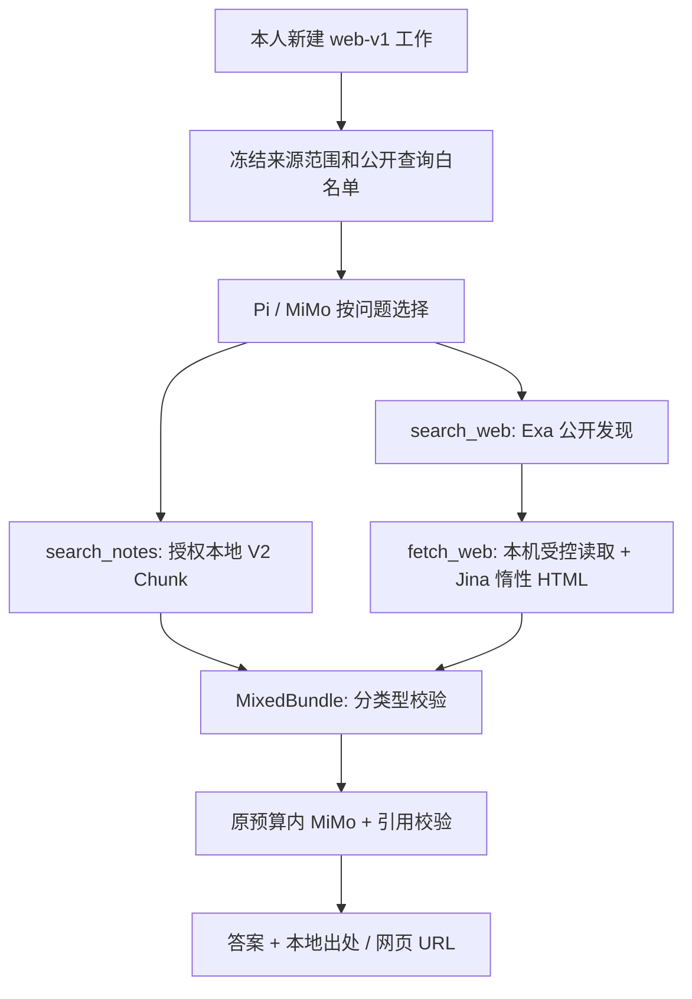

# Agent 联网检索增量切片

2026-10-18，状态：checkout 中的显式实验协议，未部署。生产仍为 `retrieval-v2-de593bc25486b7cc`。本页区分代码、配置、模拟联调和真实验收；历史发布记录不改写。

## 审计结论与最小交付

| 调用路径 | 原实现与问题 | 本轮结果 |
|---|---|---|
| `research.search → mcporter` | 仅显式 PA1 research 可用；扫描整段输出中的 HTTPS URL；未传当前 Exa 必填 `objective` | 复用独立 Provider，结构化解析优先，兼容有标题／URL 字段的旧 MCP 记录，拒绝无法识别的格式；不收集正文随附链接 |
| `research.fetch → Jina(URL)` | 来源跳转由远端执行，本机无法控制；旧 DNS 校验放行代理 benchmark 网段 | 新读取先由本机核验 DNS、固定 TLS 连接地址、逐跳检查 HTTPS，再将无脚本／属性／链接的惰性 HTML POST 给 Jina；拒绝 benchmark 网段。旧 research 新读取也复用此适配器 |
| `AgentHost → ToolMiMo → Pi` | 默认只声明 `search_notes`，初始要求检索笔记；工具文本次序是付费身份的一部分 | 新建显式 `agent-web-v1` 会话可选三工具；旧 TOOLS、SYSTEM、序列化与检查点不变 |
| 证据检查 | 本地 ContextBundle 要读取原文件，不能检查公开网页 | 新 MixedBundle 对 V2 本地位置／权限与公开网页快照／哈希／时效分别检查；渠道校验按协议分派 |
| 外部账户正文 | 已有只读 detail、缓存、reconcile；展示又额外要求 MiMo 授权 | 增加明确条目的 `reading retrieve --fetch-body` 串接账户读取与 V2，分别检查模型和渠道权限；只读飞书 V2 不再额外依赖模型许可 |

本轮没有实现远程一条指令自动获取账户正文、自动分类、自动授予披露权限、账户工具自主拉取、联网角色协作或后台更新。新 Agent 可检索已经入索引且具备现行 MiMo／渠道许可的账户正文；本机实际三来源仍没有这些披露配置。知乎、公众号排除。

## 实机核对的层级

- `agent-reach doctor --json` 报告 Web/Jina 后端可用；这是能力检查，不是本轮正文读取成功。其小红书 OpenCLI 检查不能代表项目实际的独立 MCP。
- `mcporter list exa --schema --output json` 成功取得现有 `https://mcp.exa.ai/mcp` 工具元数据；`web_search_exa` 要求 `query` 与 `objective`，可选 `numResults`，当前不提供 recency 参数。**本轮没有执行真实搜索**。
- WUCAI／Folo／小红书：配置 enabled，Keychain 凭据可取，缓存分别 24／9／8 条。此前真实读取记录分别在 WUCAI、Folo、XHS 验收文档；本轮没有重新读取真实私人正文、验证登录有效性或取得全文。
- 三者当前 `model_providers=[]`、`remote_metadata=false`、`remote_evidence=false`；不能宣称已进入模型上下文或飞书可展示。账户正文可读、索引存在、全文完整、允许披露是不同状态。
- Mac PA0、PA1、小红书服务进程存在；隧道进程存在但最近退出码为 255，不能据此声称当前端到端畅通。本轮没有重启或部署。
- 严格读取拒绝代理解析得到的 `198.18/15` 等地址；如果本机代理使用这种 DNS，返回明确缺口，须另外验证公共 DNS／网络路径，不能为通过测试重新放行非公网目标。

## 工具与路由契约



`search_notes(query)` 保留名称，在新协议内部使用 V2；来源显式限定，首次真正调用该工具时才加载既有离线 Embedding，失败仍有 lexical。旧协议继续原 `build_bundle`。

`search_web(query, max_results=5, recency_days=null)` 只接受调用人另外批准的精确公开查询，最多三条白名单；Agent 可决定时机和选哪条，不能自行拼接私人问题或生成未获准改写。返回结构化发现结果、摘要完整性、来源 URL、未核实发布日期、抓取时间、缺口和状态。`recency_days` 为 1–365，本轮在本机按 Provider 报告日期筛选；未知日期和过期／未来日期均排除，不能宣称服务端覆盖整个时间窗。日期未经交叉核实。

`fetch_web(url, max_chars=2400)` 只允许本工作已经搜索到的 URL；不允许工具文本临时授权其他目标。返回最大片段、原始与最终 URL、哈希、抓取时间、日期未知状态、提取方式和局限。搜索摘要无 E 编号；读取正文后才进入可引用证据。不抓登录页、不传 Cookie、不使用账户连接器凭据。

单纯个人问题可仅用本地；当期公开问题可只联网，不需要个人来源；联合分析显式加来源与公开查询；问候／倾听窄规则进入无工具的当前消息回应。其他不需要查资料的对话可显式 `--mode conversation`。这不是完整 Intent Planner；真实 MiMo 能否稳定选择正确路线尚未验收，模拟测试验证的是执行与拒绝边界。

## Evidence 与有效性

| 类型 | 身份与归属 | 复核与限制 |
|---|---|---|
| 本地／账户缓存 `local_v2` | 现有 Source → Document → Chunk；source_item_id、版本、原文字符／行位置、author、content_kind、attribution_actor | 重新读取源字节和缓存 manifest；检查根目录身份、MiMo／私密／渠道许可、删除、过期和原文位置；不把作者划线当个人经验 |
| 公开正文 `public_web` | source_id 为 public_web，URL 派生 document_id，canonical_url、片段哈希、external_author_not_owner_fact | 本工作快照，一小时有效；正文哈希、URL 形状、时间重核；不会当成本地路径检查，不会隐式重新抓取；过期结果失效而不重放付费调用 |
| 搜索发现 | search_snippet，summary，Provider 报告日期／未知 | 只用于挑选 URL，不冒充正文，不生成正文证据编号 |

公开静态读取始终标 `partial`，既不承诺全文，也不把抓取时间作为发布日期。Jina 转换后的片段不能宣称有 HTML 原文字符位置；本地 Chunk 保留可验证原文位置。新协议引用编号在本工作稳定，最终本地出处与网页 URL 分别显示。纯引用编号合法不证明 Faithfulness。

同一最终网页在一次工作内只生成一个公开证据身份；跨账户来源已有 V2 原作品关系。公开网页与账户到达关系的完整跨源统一去重、来源删除通知、网页缓存重建／长期索引仍为后续阶段。公开快照保存在私密 work 会话，沿既有30天载荷清理；小时级有效性检查早于物理清理，不进入常驻公共索引。

## 隐私、SSRF 与费用边界

精确公开查询白名单是披露权威；规则拒绝换行、路径、URL、邮箱、长数字、凭据模式和明显个人自述／私密标记，不偷偷改写查询。它不是完整 PII 分类器，用户仍须只批准可公开关键词。默认不把完整个人问题或笔记发送给 Exa/Jina；MiMo 继续只接收本工作既有授权的相关上下文。

源站仅 HTTPS/443、域名、无认证信息；禁止 IP literal、私网／环回／保留／benchmark DNS、敏感参数名、碎片和控制字符。DNS 解析在4秒可终止子进程中执行，每跳所有地址均需公网；TLS 固定连接已核验 IP，按原域名校验证书。最多三次重定向，每跳重核，禁止降级；不使用环境代理、Cookie、Authorization 或远端请求体。响应仅 HTML／纯文本／JSON 等受限类型，不解压，最大256 KiB；子进程 stdout＋stderr 也边读边限长。

Jina 只接收本机已经读取并剥除活动标签、属性、媒体与 URL 的惰性 HTML，不传 base URL，不要求远端浏览原地址。Jina POST 禁止重定向；失败后使用本机静态文本，注明降级，不重试 Jina。动态页面、PDF／Office、OCR和登录正文不在此读取范围内。账户仍走独立只读连接器，不借公开 Reader 绕过账户授权。

| 上限 | 新协议值与行为 |
|---|---|
| 模型 | 沿用现有 MiMo、100k Token/日、1m/月及现有 prompt/completion 限额；不自动增加。最多6轮，最后一轮只能回答 |
| 工具 | 本地检索3次、公开搜索2次、正文读取3次，互不替代；每次搜索最多5条 |
| 正文／上下文 | 每篇200–2400字符；总证据按6144字节选入，完整模型输入另受原8192字节默认限制；达到上限可能返回缺口或停止新调用 |
| 网络 | 搜索子进程25秒；HTTP单次12秒、DNS4秒；每个新联网操作保守预留34秒，总耗时90秒；超时不重试 |
| 独立费用记录 | 私密 work 会话中 web_usage 记录搜索／读取次数、网络秒数、请求摘要和 provider_cost=unknown；MiMo Token 仍由原事务账本计费。不是可核算人民币账单或跨工作 Web 日额度 |

同一查询或 URL 在工作内不重复联网，不因修改结果数／长度就重试。网络执行前记录 WorkStore execution；中断后未知动作阻止恢复自动重试；成功回执和规范化工具文本原子提交，恢复直接复用。429、超时、服务失败、未知格式返回缺口，不用模型常识假装实时读取。新增网络操作可能有 Provider 费用，匿名 MCP 不等于无限或免费；本轮仅模拟搜索／读取／生成，未发生实际 Exa/Jina/MiMo 调用费用。

## 本机操作与账户正文入口

下列新能力仅在 checkout，生产 `/asis` 尚不能创建 web-v1 工作。例子可能调用真实服务，离线测试不运行这些命令：

```sh
# 纯公开：没有个人来源，仍受现有 MiMo 总预算约束
scripts/asis-agent run --web --query '近期缓存一致性研究有哪些公开进展' \
  --public-query 'cache coherence official developments' --request-id NEW_ID
# 联合：私人问题不发给搜索，只外发单独指定的公开查询
scripts/asis-agent run --web --source study --query '结合我的笔记比较公开研究进展' \
  --public-query 'cache coherence official developments' --request-id ANOTHER_NEW_ID
# 恢复完全采用保存协议、工具、白名单和回执，不加 --web 或新查询
scripts/asis-agent resume --request-id NEW_ID

# 外部账户：只读获取明确条目，再按本地权限检索，保留原文／批注归属
scripts/asis reading retrieve --source folo --item-id ITEM_ID --query '关键词' --fetch-body
# 不抓取；分别核对已有模型／飞书许可；不会创建许可或调用模型／发送消息
scripts/asis reading retrieve --source folo --item-id ITEM_ID --query '关键词' --for-model --channel feishu
```

新账户版本仍需本机分类，默认 unclassified/private；不会为打通演示自动提升普通分类。若 MiMo 或渠道未授权，返回无获准正文；读取成果可以留在本机，不擅自扩大披露。飞书既有 `/asis retrieve-v2 reading_folo | 关键词` 可在已有渠道许可后展示缓存 Chunk；本轮仅修复其权限分离并测试，**未部署、未新增远程账户抓取命令、未发送飞书消息**。新结果的渠道复核和 URL 格式器已支持，但从飞书创建联网工作与完整卡片交互仍待接线和真人验收。

## 验证、后续和回退

复现实验使用标准 unittest、合成笔记、真实 Pi＋模拟 MiMo/Web Provider；没有真实私人正文快照。适配器测试覆盖结构化解析／schema漂移、未知日期、恶意网页、URL／DNS／重定向／响应上限／超时；Agent 测试覆盖个人／公开／混合、缺口、查询白名单、读搜次数、网络时间、旧付费协议恢复、新协议原子回执复用和过期；账户测试覆盖按需 detail→index→Chunk、原文／划线／批注、metadata、删除／过期／撤权以及模型／渠道许可分离。

```sh
PYTHONPATH=src python3 -m unittest discover -s tests -v
```

准确数量与跳过项见[本轮记录](validation/web-search-20261018.json)。模拟模型的引用成功不证明真实 MiMo 路由、语义正确性或服务可用性；真实 Exa 搜索、Jina POST 和当期公开任务、真实账户的新正文及飞书 UI 仍未验收。Retrieval Quality Gate 未通过，本轮新协议属于显式实验，不能切换默认入口。

本轮基线441项＝424通过＋17跳过；最终481项＝464通过＋17跳过，0失败，新增40项全部通过。17项分别为14项VPS AstrBot SDK、1项PDF测试依赖、2项LibreOffice/UNO环境。初次扩展测试查出 JSON序列化后扫描漏掉标题的行首凭据模式，已修复为原字段逐项扫描，再跑完整集通过；保留这个失败与修复记录，不伪装为从未失败。最终回归还覆盖不读取旧笔记的纯公开会话、对慢速HTTP响应头的绝对截止时间与已撤权工作的零新增模型调用。

接下来优先：① 在不外发私人资料的真实公开查询上验证 Exa/Jina/MiMo，并解决 DNS 路径与质量 Gate；② 把账户正文的局部分类、披露许可和显式远程请求接成可审计闭环，保持知乎排除；③ 再接飞书新工作创建、URL卡片和真实联合分析验收。Planner、Reranker、跨公共／账户来源统一去重、专业角色联网、Brave/Tavily 适配器均未实现。

回退：不使用 `--web`，默认旧 Agent 保持原协议；不运行 `reading retrieve --fetch-body` 即不新增账户抓取。无 work.sqlite3 schema 迁移，无新增常驻服务或生产配置修改。旧代码应保留现有私密数据库，暂停新 web-v1 工作且不能将其改为旧协议恢复；如撤销本轮代码，新协议工作不可继续，只保留原防重／费用标记，不能删账本后重跑。安全 Reader 与解析修复也影响将来 checkout 旧 research 的新请求，严格 DNS可能减少可读站点，这是明确的兼容边界；生产旧包不受本轮差异影响。

参考实际接口：[Exa MCP 实现](https://github.com/exa-labs/exa-mcp-server)、[Jina Reader](https://github.com/jina-ai/reader)、[Jina HTML POST 示例](https://github.com/jina-ai/reader/blob/main/cookbooks.md#raw-html)。复用本机已有服务，不照搬宽松浏览器导航，不新增收费 Provider 或模型。
